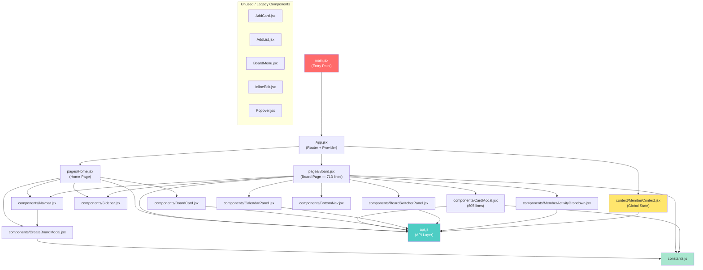
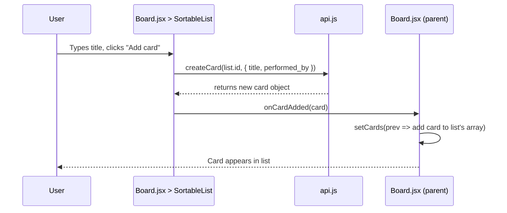
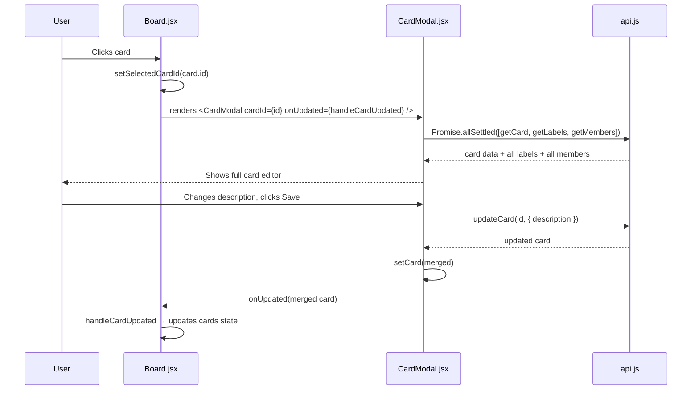
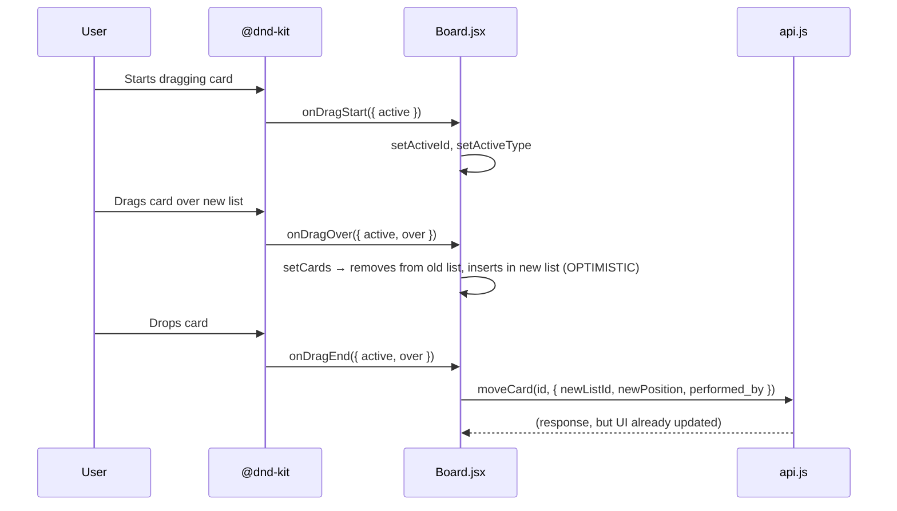

# 📋 KnabanX — In-Depth Frontend Code Explanation
# Every File, Every Function, Every Connection

---

## FRONTEND FILE DEPENDENCY MAP



---

## 1. `main.jsx` — The Application Entry Point

**File**: [`main.jsx`](file:///Users/amanpatel/projects/Kanban_Board_Application/frontend/src/main.jsx) (13 lines)

```jsx
import { StrictMode } from 'react'
import { createRoot } from 'react-dom/client'
import './styles/base.css'
import './styles/home.css'
import './styles/board.css'
import './styles/cardmodal.css'
import App from './App.jsx'

createRoot(document.getElementById('root')).render(
  <StrictMode>
    <App />
  </StrictMode>,
)
```

### What It Does
This is the very first JavaScript file that runs when the browser loads your app. It:
1. **Imports all global CSS files** (lines 3-6) — This is important because it means ALL styles are loaded globally at boot, not lazily per-component.
2. **Finds the `<div id="root">` element** in `index.html` (line 9).
3. **Mounts the entire React tree** into that DOM element.
4. **Wraps everything in `<StrictMode>`** (line 10) — This causes React to render every component **twice** in development mode to catch bugs (like missing cleanup in `useEffect`). It has **zero effect** in production.

### Connections
| Connects To | How |
|---|---|
| `App.jsx` | Renders `<App />` as the root component |
| `styles/*.css` | Loads all 4 CSS files globally |
| `index.html` | Targets the `#root` div |

### Interview Tip
**Q:** "Why `createRoot` instead of `ReactDOM.render`?"
**A:** "`createRoot` is the React 18+ API. The old `ReactDOM.render` is deprecated. `createRoot` enables concurrent features like automatic batching of state updates."

---

## 2. `App.jsx` — Routing & Global Provider

**File**: [`App.jsx`](file:///Users/amanpatel/projects/Kanban_Board_Application/frontend/src/App.jsx) (17 lines)

```jsx
import { BrowserRouter, Routes, Route } from 'react-router-dom';
import { MemberProvider } from './context/MemberContext';
import Home from './pages/Home';
import Board from './pages/Board';

export default function App() {
  return (
    <MemberProvider>
      <BrowserRouter>
        <Routes>
          <Route path="/" element={<Home />} />
          <Route path="/board/:id" element={<Board />} />
        </Routes>
      </BrowserRouter>
    </MemberProvider>
  );
}
```

### What It Does
This is the **root component** that defines the entire application structure:

1. **`<MemberProvider>`** (line 8) — Wraps EVERYTHING. This means the `currentMember` context is available in **every single component** in the app. This is placed OUTSIDE `BrowserRouter` so that even routing-level operations can access member data.

2. **`<BrowserRouter>`** (line 9) — Enables client-side routing. The browser URL changes WITHOUT full page reloads. Uses the History API (`pushState`/`popState`).

3. **Two Routes** (lines 11-12):
   - `/` → Renders `<Home />` (the board listing page)
   - `/board/:id` → Renders `<Board />` (a specific board). The `:id` is a **URL parameter** — when the URL is `/board/5`, `useParams()` inside `Board.jsx` returns `{ id: '5' }`.

### Connections
| Connects To | How | Why |
|---|---|---|
| `MemberContext.jsx` | Imports & renders `<MemberProvider>` | Provides global member state |
| `pages/Home.jsx` | Renders at `/` route | Home page |
| `pages/Board.jsx` | Renders at `/board/:id` route | Board detail page |
| `react-router-dom` | Uses `BrowserRouter`, `Routes`, `Route` | Client-side routing |

### Why This Architecture Matters
The **nesting order** is critical:
```
MemberProvider (global state layer)
  └── BrowserRouter (routing layer)
       └── Routes (page switching)
            ├── Home
            └── Board
```
If `BrowserRouter` was OUTSIDE `MemberProvider`, the `MemberProvider` would unmount and remount when navigating between pages, losing state.

---

## 3. `api.js` — The Centralized API Layer

**File**: [`api.js`](file:///Users/amanpatel/projects/Kanban_Board_Application/frontend/src/api.js) (55 lines)

### Line-by-Line Breakdown

```javascript
// Line 1: Build the base URL. In development: http://localhost:5001/api
// In production: whatever VITE_API_URL is set to (e.g., https://knabanx.onrender.com/api)
const BASE = (import.meta.env.VITE_API_URL || 'http://localhost:5001') + '/api';
```
- `import.meta.env.VITE_API_URL` — Vite injects environment variables that start with `VITE_` at build time.
- The `|| 'http://localhost:5001'` is a fallback for local development.

```javascript
// Lines 3-9: The universal request wrapper
const req = async (url, opts = {}) => {
  const r = await fetch(BASE + url, { 
    headers: { 'Content-Type': 'application/json' }, 
    cache: 'no-store',  // NEVER use browser cache — always get fresh data
    ...opts            // Spread any custom options (method, body, etc.)
  });
  if (r.status === 204) return null;          // 204 No Content = success, no body
  const data = await r.json();                // Parse the JSON response
  if (!r.ok) throw new Error(               // If status >= 400, throw an error
    (data && data.error && data.error.message) || 'API Error'
  );
  return data;                                // Return parsed data
};
```

**Why this pattern is smart:**
- Every API call in the app goes through this ONE function
- Error handling is centralized — components don't need to check `r.ok` themselves
- The `cache: 'no-store'` prevents stale data issues (critical for a collaborative board)
- The `...opts` spread means you can override any defaults

### All Exported API Functions (Lines 12-55)

| Function | HTTP Method | Endpoint | Used By |
|---|---|---|---|
| `getBoards(memberId)` | GET | `/boards?member_id=X` | Home.jsx, BoardSwitcherPanel.jsx, CalendarPanel.jsx |
| `createBoard(data)` | POST | `/boards` | CreateBoardModal.jsx |
| `getBoard(id, memberId)` | GET | `/boards/:id?member_id=X` | Board.jsx, CalendarPanel.jsx |
| `updateBoard(id, data)` | PATCH | `/boards/:id` | Board.jsx (title, background) |
| `deleteBoard(id)` | DELETE | `/boards/:id` | Board.jsx (BoardMenuPanel) |
| `toggleStarBoard(id, memberId)` | POST | `/boards/:id/toggle-star` | BoardCard.jsx, Board.jsx |
| `getBoardActivity(id, memberId)` | GET | `/boards/:id/activity` | Board.jsx (BoardMenuPanel), MemberActivityDropdown.jsx |
| `createList(boardId, data)` | POST | `/boards/:boardId/lists` | Board.jsx (AddListForm), CalendarPanel.jsx |
| `updateList(id, data)` | PATCH | `/lists/:id` | Board.jsx (SortableList) |
| `reorderList(id, data)` | PATCH | `/lists/:id/reorder` | Board.jsx (onDragEnd) |
| `deleteList(id)` | DELETE | `/lists/:id` | Board.jsx (BoardMenuPanel) |
| `searchCards(q)` | GET | `/cards/search?q=X` | Navbar.jsx |
| `createCard(listId, data)` | POST | `/lists/:listId/cards` | Board.jsx (SortableList), CalendarPanel.jsx |
| `getCard(id)` | GET | `/cards/:id` | CardModal.jsx |
| `updateCard(id, data)` | PATCH | `/cards/:id` | Board.jsx, CardModal.jsx |
| `moveCard(id, data)` | PATCH | `/cards/:id/move` | Board.jsx (onDragEnd) |
| `deleteCard(id)` | DELETE | `/cards/:id` | Board.jsx (BoardMenuPanel) |
| `getLabels()` | GET | `/labels` | CardModal.jsx |
| `addCardLabel(cardId, data)` | POST | `/cards/:cardId/labels` | CardModal.jsx |
| `removeCardLabel(cardId, labelId)` | DELETE | `/cards/:cardId/labels/:labelId` | CardModal.jsx |
| `getMembers()` | GET | `/members` | MemberContext.jsx, CardModal.jsx, MemberActivityDropdown.jsx |
| `addCardMember(cardId, data)` | POST | `/cards/:cardId/members` | CardModal.jsx |
| `removeCardMember(cardId, memberId)` | DELETE | `/cards/:cardId/members/:memberId` | CardModal.jsx |
| `addChecklistItem(cardId, data)` | POST | `/cards/:cardId/checklist-items` | CardModal.jsx |
| `updateChecklistItem(id, data)` | PATCH | `/checklist-items/:id` | CardModal.jsx |
| `deleteChecklistItem(id)` | DELETE | `/checklist-items/:id` | CardModal.jsx |
| `addAttachment(cardId, data)` | POST | `/cards/:cardId/attachments` | CardModal.jsx |
| `deleteAttachment(cardId, attId)` | DELETE | `/cards/:cardId/attachments/:attId` | CardModal.jsx |
| `addComment(cardId, data)` | POST | `/cards/:cardId/comments` | CardModal.jsx |
| `deleteComment(cardId, commentId)` | DELETE | `/cards/:cardId/comments/:commentId` | CardModal.jsx |

### Interview Tip
**Q:** "Why create a centralized API layer instead of calling `fetch` directly in components?"
**A:** "Three reasons: (1) DRY — error handling, headers, and base URL are defined once. (2) Testability — I can mock `api.js` in unit tests. (3) Maintainability — if I switch from `fetch` to `axios`, I only change one file."

---

## 4. `constants.js` — Configuration Data

**File**: [`constants.js`](file:///Users/amanpatel/projects/Kanban_Board_Application/frontend/src/constants.js) (50 lines)

### What It Exports

| Constant | Count | Used By | Purpose |
|---|---|---|---|
| `BOARD_COLORS` | 10 solid hex colors | CreateBoardModal, Board.jsx (BoardMenuPanel) | Board background color options |
| `BOARD_GRADIENTS` | 10 CSS gradients | CreateBoardModal, Board.jsx, CardModal | Board background gradient options |
| `BOARD_IMAGES` | 5 Unsplash URLs | CreateBoardModal, Board.jsx, CardModal | Board background image options |
| `LABEL_COLORS` | 10 hex colors | (defined but used on backend for seed data) | Label color palette |
| `COVER_COLORS` | 10 hex colors | CardModal.jsx | Card cover color options |
| `LIST_COLORS` | 20 hex colors | Board.jsx (SortableList) | List background color options |
| `LIST_GRADIENTS` | 8 CSS gradients | Board.jsx (SortableList) | List background gradient options |

### Why It Exists
Rather than hardcoding color values inside components, all visual constants are in one file. This means:
- Changing a color palette updates it **everywhere** at once
- Components stay clean (no long arrays of hex codes inline)
- Easy to add new colors/images later

### Connection Pattern
```
constants.js ──exports──→ CreateBoardModal (board bg picker)
             ──exports──→ Board.jsx > SortableList (list color picker)
             ──exports──→ Board.jsx > BoardMenuPanel (board bg changer)
             ──exports──→ CardModal.jsx (card cover picker)
```

---

## 5. `context/MemberContext.jsx` — Global State Management

**File**: [`MemberContext.jsx`](file:///Users/amanpatel/projects/Kanban_Board_Application/frontend/src/context/MemberContext.jsx) (32 lines)

```jsx
import { createContext, useContext, useState, useEffect } from 'react';
import { getMembers } from '../api';

const MemberCtx = createContext(null);

export function MemberProvider({ children }) {
  const [members, setMembers] = useState([]);
  const [currentMember, setCurrentMember] = useState(null);

  useEffect(() => {
    getMembers().then(list => {
      setMembers(list);
      const saved = localStorage.getItem('currentMemberId');
      const found = saved ? list.find(m => String(m.id) === saved) : null;
      setCurrentMember(found || list[0] || null);
    });
  }, []);

  const switchMember = (member) => {
    setCurrentMember(member);
    localStorage.setItem('currentMemberId', member.id);
  };

  return (
    <MemberCtx.Provider value={{ members, currentMember, switchMember }}>
      {children}
    </MemberCtx.Provider>
  );
}

export const useMember = () => useContext(MemberCtx);
```

### Deep Explanation

**Line 4**: Creates a React Context object initialized to `null`. Context lets you pass data through the component tree without prop-drilling.

**Lines 10-17** (`useEffect`):
- Runs ONCE on app startup (empty `[]` dependency array)
- Calls `GET /api/members` to fetch all team members from the database
- **Persistence logic** (lines 13-15): Checks `localStorage` for a previously selected member ID. If found AND that member still exists in the database list, uses that member. Otherwise defaults to the first member.
- This is why switching members **persists across browser refreshes** — the ID is saved in `localStorage`.

**Lines 19-22** (`switchMember`):
- Updates React state AND saves to `localStorage` simultaneously
- Every component consuming this context will **re-render** when `currentMember` changes

**Line 26**: The Provider passes down **three values**:
- `members` — full array of all team members (used by Navbar member switcher, CardModal member assignment)
- `currentMember` — the currently active member object (used by almost every component)
- `switchMember` — function to change the active member (used by Navbar)

### Who Uses This Context?

| Component | What It Uses | Why |
|---|---|---|
| `Home.jsx` | `currentMember` | Fetches boards filtered by this member |
| `Board.jsx` | `currentMember` | Passes `performed_by` to API calls, fetches board with member's star status |
| `Navbar.jsx` | `members`, `currentMember`, `switchMember` | Shows avatar, member switcher dropdown |
| `BoardCard.jsx` | `currentMember` | Sends member ID when toggling star |
| `CardModal.jsx` | `currentMember` | Shows current member's avatar in comment form, passes `performed_by` to actions |
| `BoardSwitcherPanel.jsx` | `currentMember` | Fetches boards for this member |

### Data Flow Diagram
```
App startup
  │
  ▼
MemberProvider useEffect fires
  │
  ▼
GET /api/members → returns [{id:1, name:"Aman"}, {id:2, name:"Vardan"}, ...]
  │
  ▼
Check localStorage('currentMemberId')
  │
  ├── Found "2" → setCurrentMember(Vardan)
  └── Not found → setCurrentMember(Aman)  // first in list
  │
  ▼
All children re-render with currentMember available via useMember()
```

---

## 6. `pages/Home.jsx` — The Home / Dashboard Page

**File**: [`Home.jsx`](file:///Users/amanpatel/projects/Kanban_Board_Application/frontend/src/pages/Home.jsx) (152 lines)

### State Variables (Lines 12-18)

| State | Type | Purpose |
|---|---|---|
| `boards` | `Board[]` | All boards for the current member |
| `showModal` | `boolean` | Controls the CreateBoardModal visibility |
| `error` | `string` | Stores API error message for display |
| `view` | `string` | Switches between `'boards_global'` and `'billing'` views |
| `sidebarOpen` | `boolean` | Mobile sidebar toggle |

### Data Fetching (Lines 20-25)

```jsx
useEffect(() => {
  if (!currentMember) return;
  getBoards(currentMember.id)
    .then(setBoards)
    .catch(err => setError(err.message || 'Failed to connect to backend database'));
}, [currentMember]);
```

- **Guards against null**: If `MemberContext` hasn't loaded yet, `currentMember` is `null`, so we skip the fetch.
- **Re-fetches when member changes**: The `[currentMember]` dependency means switching members via Navbar re-triggers this fetch.
- **Error handling**: Catches network errors and shows them in the UI.

### Derived State (Lines 31-32)

```jsx
const starredBoards = useMemo(() => boards.filter(b => b.is_starred), [boards]);
const recentBoards = useMemo(() => boards.slice(0, 4), [boards]);
```

- `useMemo` prevents re-computing these on every render — only recalculates when `boards` changes.
- `starredBoards` — Boards the current member has starred (star status comes from the backend JOIN with `board_stars` table).
- `recentBoards` — Just the first 4 boards (not truly "recently viewed" — no tracking exists for that).

### Component Layout

```
<Home>
  ├── <Navbar onToggleSidebar={...} />
  ├── <div className="sidebar-backdrop"> (mobile overlay)
  ├── <div className="app-body">
  │     ├── <Sidebar currentView={view} onViewChange={...} sidebarOpen={...} />
  │     └── <main className="home-main">
  │           ├── (if error) → API Error alert
  │           ├── (if view is boards) →
  │           │     ├── Starred Boards section → BoardCard[]
  │           │     ├── Recently Viewed section → BoardCard[]
  │           │     └── Your Workspaces section → BoardCard[] + "Create new board" button
  │           └── (if view is billing) → Premium promo card
  └── (if showModal) → <CreateBoardModal ... />
```

### Star Toggle Callback (Lines 27-29)

```jsx
const onStarredChanged = (boardId, isStarred) => {
  setBoards(prev => prev.map(b => b.id === boardId ? { ...b, is_starred: isStarred } : b));
};
```
This is a **callback** passed down to each `<BoardCard>`. When a user clicks the star icon on a board card, `BoardCard` calls the API and then calls this function to update the parent's state so the board appears/disappears from the starred section **immediately** without re-fetching.

### Board Creation Flow (Lines 139-149)

```jsx
{showModal && (
  <CreateBoardModal 
    onClose={() => setShowModal(false)} 
    memberId={currentMember?.id}
    onCreated={b => { 
      setBoards(p => [b, ...p]);      // Add new board to the start of the list
      setShowModal(false);             // Close the modal
      navigate(`/board/${b.id}`);      // Navigate to the new board
    }} 
  />
)}
```
After creating a board, the user is **immediately navigated** to it.

### Connections

| Connects To | How | Data Flow |
|---|---|---|
| `Navbar.jsx` | Renders as child | Passes `onToggleSidebar` callback |
| `Sidebar.jsx` | Renders as child | Passes `currentView`, `onViewChange`, `sidebarOpen` |
| `BoardCard.jsx` | Renders N instances | Passes `board` data + `onStarredChanged` callback |
| `CreateBoardModal.jsx` | Conditionally renders | Passes `memberId`, `onCreated`, `onClose` |
| `MemberContext.jsx` | Uses `useMember()` | Reads `currentMember` for API calls |
| `api.js` | Calls `getBoards()` | Fetches boards on mount + member change |

---

## 7. `pages/Board.jsx` — The Heart of the Application (713 Lines)

**File**: [`Board.jsx`](file:///Users/amanpatel/projects/Kanban_Board_Application/frontend/src/pages/Board.jsx) (713 lines)

This is the **largest and most complex file** in the entire project. It contains the main Board page component plus 6 sub-components defined in the same file.

### Components Defined in This File

| Component | Lines | Purpose |
|---|---|---|
| `Board` (default export) | 24-347 | Main board page with DnD context |
| `SortableList` | 349-471 | A single draggable list column |
| `SortableCard` | 473-481 | A single draggable card |
| `CardContent` | 483-533 | Card visual content (labels, badges, due dates) |
| `CardItemOverlay` | 535 | Ghost card shown during drag |
| `ListOverlay` | 536-545 | Ghost list shown during drag |
| `AddListForm` | 547-558 | "Add another list" form |
| `BoardMenuPanel` | 560-713 | Slide-out menu (background, archives, activity) |

---

### 7a. `Board` Component (Lines 24-347)

#### State Variables (Lines 28-44)

| State | Type | Purpose |
|---|---|---|
| `board` | `object \| null` | Board metadata (title, bg_type, bg_value, archived_cards, etc.) |
| `lists` | `List[]` | Array of list objects (id, title, position, color) |
| `cards` | `{ [listId]: Card[] }` | **Object** mapping list IDs to their card arrays. This structure is key — it makes it O(1) to find a list's cards. |
| `activeId` | `number \| null` | ID of the currently dragged item |
| `activeType` | `'card' \| 'list' \| null` | Whether a card or list is being dragged |
| `selectedCardId` | `number \| null` | Which card's modal is open |
| `menuOpen` | `boolean` | Board menu panel visibility |
| `editBoardTitle` | `boolean` | Whether board title is in edit mode |
| `boardTitle` | `string` | Controlled input for board title editing |
| `starred` | `boolean` | Star status for the current member |
| `showShare` | `boolean` | Share modal visibility |
| `showFilter` | `boolean` | Filter panel (defined but not used in UI) |
| `plannerOpen` | `boolean` | CalendarPanel visibility |
| `boardsOpen` | `boolean` | BoardSwitcherPanel visibility |
| `showMemberActivity` | `boolean` | MemberActivityDropdown visibility |
| `archiveStack` | `Card[]` | Stack of recently archived cards for **Ctrl+Z undo** |
| `sidebarOpen` | `boolean` | Mobile sidebar toggle |

#### Data Fetching — `fetchBoardData` (Lines 46-57)

```jsx
const fetchBoardData = useCallback(() => {
  getBoard(id, currentMember?.id).then(data => {
    setBoard(data);
    setBoardTitle(data.title);
    setStarred(data.is_starred);
    setLists(data.lists);
    const byList = {};
    data.lists.forEach(l => { byList[l.id] = []; });
    data.cards.forEach(c => { if (byList[c.list_id]) byList[c.list_id].push(c); });
    setCards(byList);
  });
}, [id, currentMember]);
```

**What happens step-by-step:**
1. Calls `GET /api/boards/:id?member_id=X` (single API call)
2. Backend returns `{ ...board, lists: [...], cards: [...], archived_cards: [...], archived_lists: [...] }`
3. Initializes empty arrays for every list: `{ 1: [], 2: [], 3: [] }`
4. Distributes cards into their list buckets based on `card.list_id`
5. Result: `{ 1: [card1, card4], 2: [card2, card5], 3: [card3] }`

**Why `useCallback`?** Because `fetchBoardData` is used as a dependency in `useEffect` (line 59-61). Without `useCallback`, a new function reference would be created every render, causing infinite re-fetches.

#### Drag-and-Drop Setup — Sensors (Lines 63-67)

```jsx
const sensors = useSensors(
  useSensor(PointerSensor, { activationConstraint: { distance: 5 } }),
  useSensor(MouseSensor,   { activationConstraint: { distance: 5 } }),
  useSensor(TouchSensor,   { activationConstraint: { delay: 250, tolerance: 5 } })
);
```

| Sensor | Device | Activation | Why |
|---|---|---|---|
| `PointerSensor` | Mouse/touch | Must move 5px | Prevents accidental drags when clicking |
| `MouseSensor` | Mouse only | Must move 5px | Fallback for PointerSensor |
| `TouchSensor` | Touch only | 250ms hold + 5px tolerance | On mobile, distinguishes drag from scroll |

#### Container Finder — `findContainer` (Lines 69-73)

```jsx
const findContainer = (id) => {
  if (lists.find(l => `list-${l.id}` === id)) return id;
  const list = lists.find(l => (cards[l.id] || []).some(c => `card-${c.id}` === id));
  return list ? `list-${list.id}` : null;
};
```

Given a DnD item ID like `"card-42"` or `"list-3"`, this function finds which list container it belongs to. This is critical for cross-list drag detection.

#### The Three Drag Handlers

**`onDragStart` (Lines 108-111)** — Records what is being dragged:
```jsx
const onDragStart = ({ active }) => {
  setActiveId(active.data.current?.id);
  setActiveType(active.data.current?.type);
};
```

**`onDragOver` (Lines 75-106)** — **OPTIMISTIC UI** — Updates state WHILE dragging:
```jsx
const onDragOver = ({ active, over }) => {
  // ... (guard clauses)
  // This fires every time the dragged card hovers over a different list
  setCards(prev => {
    // 1. Remove card from source list array
    // 2. Insert card into target list array at the hover position
    // 3. Update the card's list_id to the new list
    return { ...prev, [actListId]: filtered, [overListId]: inserted };
  });
};
```

This is **the most complex function** in the frontend. When you drag a card from "To Do" over "In Progress":
1. The card visually disappears from To Do's array
2. It appears in In Progress's array at the correct position
3. **No API call is made yet** — this is purely local state

**`onDragEnd` (Lines 113-153)** — Commits the change:
```jsx
const onDragEnd = ({ active, over, cancelled }) => {
  setActiveId(null);
  setActiveType(null);
  if (!over || cancelled) return;

  if (type === 'list') {
    // Reorder lists using arrayMove
    setLists(prev => arrayMove(prev, oldIdx, newIdx));
    reorderList(activeIdNum, { newPosition: newIdx + 1 });  // API call
    return;
  }

  if (type === 'card') {
    // Same-list reorder or cross-list move
    moveCard(activeIdNum, { 
      newListId: overListId, 
      newPosition: Math.max(0, newIdx) + 1,
      performed_by: currentMember?.id 
    });  // API call
  }
};
```

**The flow is:**
```
onDragStart → records what's dragged
     ↓
onDragOver (fires many times) → updates UI optimistically
     ↓
onDragEnd → sends ONE API call with final position
```

#### Undo System (Lines 155-167)

```jsx
useEffect(() => {
  const handleUndo = async (e) => {
    if ((e.metaKey || e.ctrlKey) && e.key === 'z') {
      if (archiveStack.length === 0) return;
      const last = archiveStack[archiveStack.length - 1];
      setArchiveStack(prev => prev.slice(0, -1));
      const restored = await updateCard(last.id, { archived: false, list_id: last.list_id, position: last.position });
      handleCardUpdated(restored);
    }
  };
  window.addEventListener('keydown', handleUndo);
  return () => window.removeEventListener('keydown', handleUndo);
}, [archiveStack]);
```

When a card is archived:
1. It's pushed onto `archiveStack` (line 291)
2. If user presses Ctrl+Z, the last archived card is restored via `PATCH /api/cards/:id`
3. The card reappears in its original list at its original position

#### `handleCardUpdated` — The Universal Card State Updater (Lines 169-195)

This function is called by:
- CardModal (after editing title, description, labels, etc.)
- onCardToggleComplete (after marking a card done)
- Undo handler (after restoring an archived card)

**Key behavior — Auto-move to Done (Lines 171-176):**
```jsx
if (updated.is_complete) {
  const doneList = lists.find(l => l.title.toLowerCase() === 'done');
  if (doneList && updated.list_id !== doneList.id) {
    patchData = await updateCard(updated.id, { list_id: doneList.id });
  }
}
```
When a card is marked complete, it **automatically moves** to the list titled "Done" (case-insensitive match).

#### Collision Detection Strategy (Lines 197-201)

```jsx
const collisionDetectionStrategy = useCallback((args) => {
  const pointerCollisions = pointerWithin(args);
  if (pointerCollisions.length > 0) return pointerCollisions;
  return closestCorners(args);
}, []);
```
Uses **two algorithms**: first tries `pointerWithin` (precise — is the mouse cursor inside a droppable?). If nothing found, falls back to `closestCorners` (geometric distance).

#### Render Structure

```
<div className="app-container" style={board background}>
  ├── <Navbar boardTitle={...} />
  ├── <CalendarPanel />
  ├── <BoardSwitcherPanel />
  ├── <div className="app-body">
  │     └── <main className="board-page">
  │           ├── Board Header (title, star, share, menu buttons)
  │           ├── <DndContext> (drag-and-drop container)
  │           │     └── <SortableContext items={listIds}>
  │           │           └── <div className="lists-row">
  │           │                 ├── SortableList[] (one per list)
  │           │                 └── <AddListForm />
  │           │           </div>
  │           │     </SortableContext>
  │           │     └── <DragOverlay> (ghost element during drag)
  │           ├── <BottomNav />
  │           └── (if menuOpen) <BoardMenuPanel />
  ├── (if showShare) Share modal
  └── (if selectedCardId) <CardModal />
```

---

### 7b. `SortableList` Component (Lines 349-471) — `React.memo` Wrapped

```jsx
const SortableList = React.memo(({ list, cards, onCardClick, onCardAdded, ... }) => {
```

**`React.memo`**: Prevents re-rendering this list when OTHER lists' cards change. Since `cards` state is `{ listId: Card[] }`, updating list 2's cards would normally re-render all lists. `React.memo` does a shallow comparison of props and skips re-render if they haven't changed.

#### `useSortable` Hook (Line 350)
```jsx
const { attributes, listeners, setNodeRef, transform, transition, isDragging } = 
  useSortable({ id: `list-${list.id}`, data: { type: 'list', id: list.id } });
```
This hook from `@dnd-kit` makes the list both **draggable** and a **drop target**. The `data` object is accessible in drag handlers via `active.data.current`.

#### Internal State (Lines 352-358)
- `listMenu` / `colorPicker` — List context menu and color sub-menu
- `editTitle` / `titleVal` — Inline title editing
- `addingCard` / `newCardTitle` — Card creation form
- `isCollapsed` — Collapse/expand list

#### Card Creation (Lines 384-390)
```jsx
const submitCard = async () => {
  if (!newCardTitle.trim()) return;
  const card = await createCard(list.id, { title: newCardTitle.trim(), performed_by: currentMember?.id });
  onCardAdded(card);               // Tell parent (Board) to add card to state
  setNewCardTitle('');              // Clear input
  cardInputRef.current?.focus();   // Keep focus for rapid card creation
};
```

### 7c. `SortableCard` Component (Lines 473-481)

```jsx
const SortableCard = React.memo(({ card, onClick, onArchive, onToggleComplete }) => {
  const { attributes, listeners, setNodeRef, transform, transition, isDragging } = 
    useSortable({ id: `card-${card.id}`, data: { type: 'card', id: card.id } });
  // ...renders CardContent
});
```
Very thin wrapper — just makes a card draggable and delegates rendering to `CardContent`.

### 7d. `CardContent` Component (Lines 483-533)

Renders the visual content of a card:
- **Cover image/color/gradient** (line 484-485, 489)
- **Label pills** (lines 491-495) — small colored dots
- **Title with checkbox** (lines 497-500) — the checkbox triggers `onToggleComplete`
- **Badges row** (lines 502-530):
  - Description icon (📄) — shows if `card.description` exists
  - Due date badge — color-coded: green (complete), red (overdue), amber (today)
  - Comment count — shows 💬 icon with count

### 7e. `BoardMenuPanel` Component (Lines 560-713)

A slide-out right panel with 4 views:
1. **Main menu** — Links to Background, Archived Items, Power-ups
2. **Background picker** — Colors, Gradients, Photos (uses constants)
3. **Archives** — Searchable list of archived cards/lists with Restore and Delete buttons
4. **Activity log** — Fetches board activity via `getBoardActivity()`

---

## 8. `components/CardModal.jsx` — The Card Detail Editor (604 lines)

**File**: [`CardModal.jsx`](file:///Users/amanpatel/projects/Kanban_Board_Application/frontend/src/components/CardModal.jsx)

### Architecture
Uses `createPortal` to render the modal **directly into `document.body`**, bypassing the normal component tree. This ensures the modal always appears on top of everything regardless of parent CSS.

### Data Loading (Lines 37-67)

```jsx
useEffect(() => {
  let active = true;
  const load = async () => {
    const [c, labels, members] = await Promise.allSettled([
      getCard(cardId),
      getLabels(),
      getMembers()
    ]);
    if (!active) return;
    // ... set state from results
  };
  load();
  return () => { active = false; };
}, [cardId]);
```

**Three parallel API calls** using `Promise.allSettled`:
- `getCard(id)` → Card with its labels, members, checklist_items, attachments, comments, activity
- `getLabels()` → All available labels in the system
- `getMembers()` → All team members

**Why `Promise.allSettled` not `Promise.all`?** `allSettled` waits for ALL promises to complete even if some fail. `Promise.all` would reject immediately if any one fails. This means the modal still shows card data even if the labels endpoint is down.

**Why the `active` flag (lines 38, 47)?** This is a **cleanup pattern** for React. If the user closes the modal before the API responds, `active` becomes `false` (line 66), preventing state updates on an unmounted component (which would cause a React warning).

### The `patch` Helper (Lines 88-94)

```jsx
const patch = async (data) => {
  const updated = await updateCard(cardId, data);
  const next = { ...card, ...updated };
  setCard(next);         // Update local modal state
  onUpdated(next);       // Tell Board.jsx to update its state too
  return next;
};
```
This is the **bridge between CardModal and Board.jsx**. Every edit (title, description, due date, cover, archive) goes through `patch`, which:
1. Sends `PATCH /api/cards/:id` to the backend
2. Merges the response into local state
3. Calls `onUpdated` which triggers `handleCardUpdated` in Board.jsx

### Feature Panels

The sidebar has 6 panels controlled by `panel` state:

| Panel | What It Does | API Calls |
|---|---|---|
| **Members** | Toggle member assignment to card | `addCardMember`, `removeCardMember` |
| **Labels** | Toggle label assignment to card | `addCardLabel`, `removeCardLabel` |
| **Checklist** | Add checklist items | `addChecklistItem` |
| **Dates** | Set/remove due date | `patch({ due_date })` |
| **Cover** | Set card cover (color/gradient/image/URL) | `patch({ cover_type, cover_value })` |
| **Attachment** | Add URL attachments | `addAttachment` |

### Activity & Comments (Lines 356-416)

Comments and activity logs are **merged and sorted by time**:
```jsx
[
  ...(card.comments || []).map(c => ({ ...c, _type: 'comment' })),
  ...(card.activity || []).map(a => ({ ...a, _type: 'activity' })),
].sort((a, b) => new Date(b.created_at) - new Date(a.created_at))
```
Each item gets a `_type` tag so the renderer knows whether to show a comment bubble or an activity log entry.

### Helper Functions (Lines 576-603)

- **`formatActivity(item)`** — Converts activity types to readable strings (e.g., `MOVE_CARD` → "moved this card from 'To Do' to 'In Progress'")
- **`panelIcon(p)`** — Returns the correct SVG icon for each sidebar panel button

### Connection Map
```
Board.jsx ──(selectedCardId, onUpdated, onClose)──→ CardModal
CardModal ──(patch → onUpdated)──→ Board.jsx handleCardUpdated
CardModal ──(getCard, getLabels, getMembers)──→ api.js
CardModal ──(COVER_COLORS, BOARD_GRADIENTS, BOARD_IMAGES)──→ constants.js
CardModal ──(currentMember)──→ MemberContext.jsx
```

---

## 9. `components/Navbar.jsx` — Global Navigation Bar

**File**: [`Navbar.jsx`](file:///Users/amanpatel/projects/Kanban_Board_Application/frontend/src/components/Navbar.jsx) (225 lines)

### Three Main Sections

#### Left Section (Lines 84-96)
- Mobile hamburger menu button → calls `onToggleSidebar`
- KnabanX logo → `<Link to="/">` navigates home

#### Center Section (Lines 99-171)
**Debounced Global Search (Lines 50-64):**
```jsx
const handleSearchChange = (e) => {
  const q = e.target.value;
  setSearchQuery(q);
  clearTimeout(searchDebounceRef.current);
  if (!q.trim()) { setSearchResults([]); return; }
  setSearchLoading(true);
  searchDebounceRef.current = setTimeout(async () => {
    const results = await searchCards(q.trim());
    setSearchResults(results || []);
    setSearchLoading(false);
  }, 300);
};
```
- **Debouncing**: Waits 300ms after the user STOPS typing before firing the API call. Without this, every keystroke would trigger an API call.
- **`clearTimeout`**: Cancels the previous pending timeout when a new keystroke arrives.
- Results are **grouped by board** using `Array.reduce()` (lines 76-80).

**Create Dropdown (Lines 153-171):**
- Clicking "Create" shows a dropdown with "Create board" option
- This renders `<CreateBoardModal>` (another modal within the navbar)

#### Right Section (Lines 174-221)
**Member Switcher:**
- Shows current member's avatar
- Dropdown lists all members with checkmarks
- Clicking a member calls `switchMember(m)` from MemberContext, then navigates to `/` (home)

### Click-Outside Pattern (Used 3 times)
```jsx
useEffect(() => {
  const h = (e) => {
    if (ref.current && !ref.current.contains(e.target)) setOpen(false);
  };
  document.addEventListener('mousedown', h);
  return () => document.removeEventListener('mousedown', h);
}, []);
```
This pattern is repeated for the member dropdown, search dropdown, and create dropdown. It attaches a global click listener that closes the dropdown if the click was outside the dropdown's DOM tree.

### Connections

| Connects To | How |
|---|---|
| `api.js` | Calls `searchCards()` for global search |
| `MemberContext.jsx` | Uses `members`, `currentMember`, `switchMember` |
| `CreateBoardModal.jsx` | Renders modal when "Create board" clicked |
| `Board.jsx` / `Home.jsx` | Rendered as child by both pages |

---

## 10. `components/Sidebar.jsx` — Left Navigation Panel

**File**: [`Sidebar.jsx`](file:///Users/amanpatel/projects/Kanban_Board_Application/frontend/src/components/Sidebar.jsx) (97 lines)

### Purpose
Provides navigation on the Home page with:
- **Boards** link (top-level)
- **Workspaces** collapsible section (hardcoded "TodiIst Workspace")
  - Boards (workspace-level)
  - Billing (shows premium promo page)
- **Promo box** at the bottom ("Try TodiIst Premium!")

### Props Received

| Prop | From | Purpose |
|---|---|---|
| `currentView` | Home.jsx | Which view is active (`boards_global`, `boards_workspace`, `billing`) |
| `onViewChange` | Home.jsx | Callback to switch views |
| `sidebarOpen` | Home.jsx | Whether sidebar is visible on mobile |

### Mobile Behavior
On mobile (controlled by CSS media queries), the sidebar is hidden by default. `sidebarOpen` adds the `mobile-open` class which makes it slide in as an overlay. The backdrop in Home.jsx/Board.jsx closes it on click.

---

## 11. `components/BoardCard.jsx` — Individual Board Thumbnail

**File**: [`BoardCard.jsx`](file:///Users/amanpatel/projects/Kanban_Board_Application/frontend/src/components/BoardCard.jsx) (44 lines)

### What It Does
Renders a single board card on the Home page with:
- Background preview (color, gradient, or image)
- Star toggle button
- Board title
- "TodiIst Workspace" label

### Star Toggle (Lines 9-17)
```jsx
const handleToggleStar = async (e) => {
  e.stopPropagation();  // Prevent the card click from navigating
  const { is_starred } = await toggleStarBoard(board.id, currentMember.id);
  onStarredChanged(board.id, is_starred);
};
```
- `e.stopPropagation()` is crucial — without it, clicking the star would ALSO navigate to the board (because the parent `div` has an `onClick` that calls `navigate`).

### Connections

| Connects To | How |
|---|---|
| `Home.jsx` | Rendered as child, receives `board` prop and `onStarredChanged` callback |
| `api.js` | Calls `toggleStarBoard()` |
| `MemberContext.jsx` | Uses `currentMember` for the star toggle API call |

---

## 12. `components/CreateBoardModal.jsx` — Board Creation Form

**File**: [`CreateBoardModal.jsx`](file:///Users/amanpatel/projects/Kanban_Board_Application/frontend/src/components/CreateBoardModal.jsx) (106 lines)

### State

| State | Default | Purpose |
|---|---|---|
| `title` | `''` | Board title input |
| `bgType` | `'image'` | Background type (image/color/gradient) |
| `bgValue` | First Unsplash image | Selected background value |
| `error` | `''` | API error message |
| `touched` | `false` | Whether user has interacted with the form |

### Key Behavior
- **Live preview** (line 44): Shows a miniature board mockup with the selected background
- **Validation**: Title required. Error only shown after `touched` is true (so no error on initial render)
- **Background picker**: Shows first 4 images + first 5 colors from constants
- **`e.stopPropagation()`** on inner div prevents closing when clicking inside the modal (the overlay `onClick` calls `onClose`)

### Connections

| Connects To | How |
|---|---|
| `Home.jsx` | Rendered conditionally, receives `memberId`, `onCreated`, `onClose` |
| `Navbar.jsx` | Also rendered from Navbar's "Create" dropdown |
| `api.js` | Calls `createBoard()` |
| `constants.js` | Uses `BOARD_COLORS`, `BOARD_GRADIENTS`, `BOARD_IMAGES` |

---

## 13. `components/CalendarPanel.jsx` — Date-Based Card Planner

**File**: [`CalendarPanel.jsx`](file:///Users/amanpatel/projects/Kanban_Board_Application/frontend/src/components/CalendarPanel.jsx) (149 lines)

### Purpose
A slide-out panel showing a monthly calendar. Clicking a date lets you create a card with that date as the due date.

### Calendar Rendering (Lines 36-103)
```jsx
const daysInMonth = (month, year) => new Date(year, month + 1, 0).getDate();
const firstDayOfMonth = (month, year) => new Date(year, month, 1).getDay();
```
- Creates a grid starting on the correct day of the week
- Empty cells for days before the 1st
- Highlights today with the `.today` class

### Card Creation Flow
1. User clicks a day → `setAddingToDate(day)` shows the popover
2. User enters title, selects target list (or creates a new list)
3. Submit calls `createCard(listId, { title, due_date: ISO_string })`
4. Calls `onCardAdded(card)` → Board.jsx's `handleCardUpdated`

### Bug Note
Line 56-58: The card creation does NOT pass `performed_by`, unlike the `SortableList` card creation which does. This means activity logs from CalendarPanel won't have a performer.

### Connections

| Connects To | How |
|---|---|
| `Board.jsx` | Rendered as child, receives `boardId`, `lists`, `onCardAdded`, `isOpen`, `onClose` |
| `api.js` | Calls `createCard()`, `createList()`, `getBoards()`, `getBoard()` |

---

## 14. `components/BoardSwitcherPanel.jsx` — Quick Board Navigation

**File**: [`BoardSwitcherPanel.jsx`](file:///Users/amanpatel/projects/Kanban_Board_Application/frontend/src/components/BoardSwitcherPanel.jsx) (70 lines)

### Purpose
A slide-out panel listing all boards. Clicking one navigates to it. Shows the current board with a checkmark.

### Data Fetching
```jsx
useEffect(() => {
  if (isOpen && currentMember) {
    setLoading(true);
    getBoards(currentMember.id).then(setBoards)...
  }
}, [isOpen, currentMember]);
```
Only fetches when the panel is **opened** (not on mount). This saves unnecessary API calls.

### Connections

| Connects To | How |
|---|---|
| `Board.jsx` | Rendered as child with `currentBoardId`, `isOpen`, `onClose` |
| `api.js` | Calls `getBoards()` |
| `MemberContext.jsx` | Uses `currentMember` |

---

## 15. `components/BottomNav.jsx` — Mobile Bottom Navigation

**File**: [`BottomNav.jsx`](file:///Users/amanpatel/projects/Kanban_Board_Application/frontend/src/components/BottomNav.jsx) (57 lines)

### Purpose
A fixed bottom navigation bar (mobile-style) with three buttons:
- **Planner** — Toggles CalendarPanel
- **Board** — Always active (you're already on the board)
- **Switch boards** — Toggles BoardSwitcherPanel

### Key Detail
This is a **pure presentational component** — no state, no API calls. It just receives callbacks and render state as props.

### Connections

| Connects To | How |
|---|---|
| `Board.jsx` | Receives `onTogglePlanner`, `onToggleBoards`, `plannerOpen`, `boardsOpen` |

---

## 16. `components/MemberActivityDropdown.jsx` — Per-Member Activity Feed

**File**: [`MemberActivityDropdown.jsx`](file:///Users/amanpatel/projects/Kanban_Board_Application/frontend/src/components/MemberActivityDropdown.jsx) (89 lines)

### Two-Screen UI
1. **Screen 1**: List of all team members (click one to see their activity)
2. **Screen 2**: Selected member's activity feed for this board

### Data Flow
```
Mount → GET /api/members → show member list
Click member → GET /api/boards/:boardId/activity?member_id=X → show activity
Click "← Members" → back to member list
```

### Connections

| Connects To | How |
|---|---|
| `Board.jsx` | Rendered conditionally with `boardId`, `onClose` |
| `api.js` | Calls `getMembers()`, `getBoardActivity()` |

---

## 17-19. Unused / Legacy Components

These files exist in the codebase but are **NOT imported or used** by any active component:

### `AddCard.jsx` (39 lines)
An older version of the "Add a card" form. **Replaced by** inline card creation inside `SortableList` (Board.jsx lines 384-390, 457-465).
- Difference: This version calls `createCard({ list_id, title, position: Date.now() })` — the new version calls `createCard(list.id, { title, performed_by })`.

### `AddList.jsx` (33 lines)
An older version of the "Add another list" form. **Replaced by** `AddListForm` defined inside `Board.jsx` (lines 547-558).
- Difference: This version calls `createList({ board_id, title, position: Date.now() })` — the new version calls `createList(boardId, { title })`.

### `BoardMenu.jsx` (50 lines)
An older, simpler version of the board menu. **Replaced by** `BoardMenuPanel` defined inside `Board.jsx` (lines 560-713).
- Difference: Only had background color/gradient changing. The new version adds Archives, Activity log, and Power-ups.

### `InlineEdit.jsx` (33 lines)
A reusable inline-edit component (click text to edit, blur to save). **Not used** — inline editing is implemented directly inside `SortableList` and `CardModal` instead.

### `Popover.jsx` (25 lines)
A reusable popover component using `createPortal` with smart positioning. **Not used** — popovers in the current code are rendered as regular divs within their parent components.

---

## 20. COMPLETE DATA FLOW DIAGRAMS

### Flow 1: Creating a Card



### Flow 2: Opening & Editing a Card



### Flow 3: Drag-and-Drop Card Move



---

## 21. CROSS-FILE STATE FLOW SUMMARY

```
┌─────────────────────────────────────────────────────────┐
│                   MemberContext.jsx                       │
│  members[], currentMember, switchMember()                │
│  ↕ localStorage persistence                             │
└──────────────┬────────────────┬──────────────────────────┘
               │                │
       ┌───────▼───────┐  ┌────▼────────────────────────┐
       │   Home.jsx     │  │      Board.jsx               │
       │                │  │                              │
       │ boards[]       │  │ board{}, lists[], cards{}    │
       │ ↕ getBoards()  │  │ ↕ getBoard()                │
       │                │  │ ↕ DnD state (activeId, etc.) │
       │ starredBoards  │  │ ↕ archiveStack[]             │
       │ recentBoards   │  │                              │
       └───┬───┬────────┘  └──┬──────┬─────┬──────┬──────┘
           │   │               │      │     │      │
     BoardCard  CreateBoard    │   CardModal │   Calendar
     Modal      │              │      │     │    Panel
                               │      │     │
                          SortableList │  BottomNav
                          SortableCard │
                          CardContent  │
                                 BoardMenuPanel
                                 BoardSwitcherPanel
                                 MemberActivityDropdown
```

Every component ultimately gets data from either:
1. **MemberContext** (who am I?)
2. **Board.jsx state** (what's on this board?)
3. **Its own API calls** (CardModal fetches its own card details)
