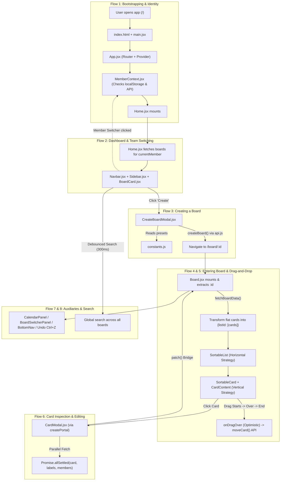

# 📋 KnabanX — Flow-Based Frontend Code Guide
# Trace the Execution Flow, Not Just Files

---

## 🧭 Why Study by Flow?

Studying a frontend project file-by-file in alphabetical order causes confusion because:
- You see `useMember()` in `Board.jsx`, but don't know who populated it.
- You see `cards` state as an object `{ 1: [...], 2: [...] }`, but don't know why it was reshaped from the API response.
- You see `createPortal` in `CardModal.jsx`, but don't know who called it or where its callbacks go.

Instead of studying files in isolation, this guide follows **8 real user execution journeys**. Each journey shows:
1. **The User Action** (what happens in the browser)
2. **The Component Chain** (who called who)
3. **The Data Handoff** (what props / context values were passed)
4. **The Code Walkthrough** (line-by-line explanation of the relevant logic)
5. **The API & State Bridge** (how the UI stays in sync with PostgreSQL)

---

## 🗺️ Master Flow Architecture



---

# 🎬 Flow 1: The App Boots Up & Identifies the User

### 1. User Action
You visit `http://localhost:5173/` in your browser.

### 2. Component Call Chain
```
index.html (#root)
  └── main.jsx
       └── App.jsx
            └── MemberProvider (MemberContext.jsx)
                 └── BrowserRouter
                      └── Routes
                           └── Route path="/" -> <Home />
```

### 3. Detailed Walkthrough & Code

#### Step 1: `main.jsx`
```javascript
// main.jsx
import { StrictMode } from 'react'
import { createRoot } from 'react-dom/client'
import './styles/base.css'
import './styles/home.css'
import './styles/board.css'
import './styles/cardmodal.css'
import App from './App.jsx'

createRoot(document.getElementById('root')).render(
  <StrictMode>
    <App />
  </StrictMode>,
)
```
- **What happens:** React finds the `<div id="root">` element in `index.html`.
- **CSS Loading:** It loads all 4 CSS files globally at boot. This means component styles don't load lazily; everything is available from millisecond zero.
- **`<StrictMode>`:** Renders components twice in development mode to detect missing cleanups in `useEffect`.

#### Step 2: `App.jsx`
```javascript
// App.jsx
import { BrowserRouter, Routes, Route } from 'react-router-dom';
import { MemberProvider } from './context/MemberContext';
import Home from './pages/Home';
import Board from './pages/Board';

export default function App() {
  return (
    <MemberProvider>
      <BrowserRouter>
        <Routes>
          <Route path="/" element={<Home />} />
          <Route path="/board/:id" element={<Board />} />
        </Routes>
      </BrowserRouter>
    </MemberProvider>
  );
}
```
- **Architecture Decision:** Notice that `<MemberProvider>` wraps `<BrowserRouter>`, which wraps `<Routes>`.
- **Why this order matters:** If `MemberProvider` were inside `BrowserRouter`, navigating between routes could cause context re-initialization. By sitting at the very root, the current user identity never resets when switching pages.

#### Step 3: `MemberContext.jsx` (Global Identity)
```javascript
// context/MemberContext.jsx
export function MemberProvider({ children }) {
  const [members, setMembers] = useState([]);
  const [currentMember, setCurrentMember] = useState(null);

  useEffect(() => {
    getMembers().then(list => {
      setMembers(list);
      const saved = localStorage.getItem('currentMemberId');
      const found = saved ? list.find(m => String(m.id) === saved) : null;
      setCurrentMember(found || list[0] || null);
    });
  }, []);
```
- **Identity Resolution:**
  1. Calls `GET /api/members` via `api.js`.
  2. Inspects `localStorage.getItem('currentMemberId')`.
  3. If a saved member exists (e.g. member ID 2), it sets `currentMember` to that member.
  4. If nothing is in `localStorage`, it defaults to the first member in the database (`list[0]`).
  5. It provides `{ members, currentMember, switchMember }` to the whole tree.

---

# 🎬 Flow 2: The Dashboard & Switching Teammates

### 1. User Action
The Home dashboard displays boards. The user clicks their avatar in the top right and switches to another teammate.

### 2. Component Call Chain
```
Home.jsx (Mounts)
  ├── Navbar.jsx (Receives onToggleSidebar)
  │    └── Member Switcher Dropdown (reads MemberContext)
  ├── Sidebar.jsx (Receives currentView, onViewChange)
  └── BoardCard.jsx (Iterates over starredBoards and recentBoards)
```

### 3. Detailed Walkthrough & Code

#### Step 1: `Home.jsx` Fetches Data
```javascript
// pages/Home.jsx
const { currentMember } = useMember();
const [boards, setBoards] = useState([]);

useEffect(() => {
  if (!currentMember) return;
  getBoards(currentMember.id)
    .then(setBoards)
    .catch(err => setError(err.message || 'Failed to connect to backend database'));
}, [currentMember]);
```
- Notice the dependency `[currentMember]`. As soon as `MemberContext` resolves the user, this `useEffect` fires.
- It calls `getBoards(currentMember.id)`: `GET /api/boards?member_id=X`.
- The database returns all boards and marks `is_starred: true/false` specifically for this member.

#### Step 2: Categorizing Boards with `useMemo`
```javascript
// pages/Home.jsx
const starredBoards = useMemo(() => boards.filter(b => b.is_starred), [boards]);
const recentBoards = useMemo(() => boards.slice(0, 4), [boards]);
```
- Rather than maintaining separate state arrays, `starredBoards` and `recentBoards` are dynamically derived from `boards`.

#### Step 3: Switching Members in `Navbar.jsx`
```javascript
// components/Navbar.jsx
const { members, currentMember, switchMember } = useMember();

// When a member is clicked in the dropdown:
<button onClick={() => { switchMember(m); setOpen(false); navigate('/'); }}>
  
  <span>{m.name}</span>
</button>
```
- `switchMember(m)` in `MemberContext.jsx` runs:
  ```javascript
  const switchMember = (member) => {
    setCurrentMember(member);
    localStorage.setItem('currentMemberId', member.id);
  };
  ```
- **The Ripple Effect:**
  1. `currentMember` state in `MemberContext` updates.
  2. `localStorage` updates so refresh keeps the new user.
  3. `Home.jsx` observes `[currentMember]` changed and re-runs its `useEffect`.
  4. The board list automatically re-fetches for the new user!

#### Step 4: Starring a Board in `BoardCard.jsx`
```javascript
// components/BoardCard.jsx
const handleToggleStar = async (e) => {
  e.stopPropagation(); // PREVENTS navigating to the board!
  try {
    const { is_starred } = await toggleStarBoard(board.id, currentMember.id);
    onStarredChanged(board.id, is_starred);
  } catch (err) { ... }
};
```
- `e.stopPropagation()` is critical: clicking the card navigates to `/board/:id`, but clicking the star button stops event bubbling.
- Calls `POST /api/boards/:id/toggle-star`.
- Calls parent `onStarredChanged(board.id, is_starred)`:
  ```javascript
  // Home.jsx
  const onStarredChanged = (boardId, isStarred) => {
    setBoards(prev => prev.map(b => b.id === boardId ? { ...b, is_starred: isStarred } : b));
  };
  ```
- The card moves in or out of the "⭐ Starred boards" section immediately without a full page reload.

---

# 🎬 Flow 3: Creating a New Board

### 1. User Action
User clicks `+ Create new board` on the dashboard or `Create` in the top Navbar.

### 2. Component Call Chain
```
Home.jsx / Navbar.jsx
  └── CreateBoardModal.jsx
       ├── constants.js (Provides BOARD_IMAGES, BOARD_COLORS)
       └── api.js (createBoard)
            └── navigate(`/board/${newBoard.id}`)
```

### 3. Detailed Walkthrough & Code

#### Step 1: `CreateBoardModal.jsx` State & Preview
```javascript
// components/CreateBoardModal.jsx
const [title, setTitle] = useState('');
const [bgType, setBgType] = useState('image');
const [bgValue, setBgValue] = useState(BOARD_IMAGES[0]);
```
- Reads default imagery and palette arrays from `constants.js`.
- Renders an interactive live mockup of the board background before creating it.

#### Step 2: Submission & Navigation
```javascript
// components/CreateBoardModal.jsx
const submit = async (e) => {
  if (e) e.preventDefault();
  setTouched(true);
  if (!title.trim()) return;
  try {
    const board = await createBoard({
      title: title.trim(),
      bg_type: bgType,
      bg_value: bgValue,
      member_id: memberId || null
    });
    onCreated(board);
  } catch (err) {
    setError(err.message || 'API Error');
  }
};
```
- In `Home.jsx`, the `onCreated` callback executes:
  ```javascript
  onCreated={b => { 
    setBoards(p => [b, ...p]); // Prepend new board
    setShowModal(false);       // Close modal
    navigate(`/board/${b.id}`); // Move immediately to Board page!
  }} 
  ```

---

# 🎬 Flow 4: Entering the Board & Constructing the Kanban Matrix

### 1. User Action
The browser navigates to `/board/5`.

### 2. Component Call Chain
```
App.jsx (Route /board/:id)
  └── Board.jsx
       ├── Navbar.jsx (with boardTitle)
       ├── CalendarPanel.jsx (Planner overlay)
       ├── BoardSwitcherPanel.jsx (Board switcher drawer)
       ├── BottomNav.jsx (Mobile navigation)
       └── DndContext (@dnd-kit/core)
            └── SortableContext (Horizontal strategy for lists)
                 ├── SortableList (Repeated for each list)
                 │    └── SortableContext (Vertical strategy for cards)
                 │         └── SortableCard (Repeated for each card)
                 │              └── CardContent (Pills, badges, cover, checkbox)
                 └── AddListForm ("+ Add another list")
```

### 3. Detailed Walkthrough & Code

#### Step 1: Extracting URL Params & Fetching
```javascript
// pages/Board.jsx
const { id } = useParams(); // Extracts '5' from /board/5
const { currentMember } = useMember();
const [board, setBoard] = useState(null);
const [lists, setLists] = useState([]);
const [cards, setCards] = useState({}); // { listId: Card[] }
```

#### Step 2: The Critical Data Transformation (Lines 46-57)
When the backend responds from `GET /api/boards/5`, it returns:
- `lists`: array of list objects `[{ id: 10, title: 'To Do' }, { id: 11, title: 'Done' }]`
- `cards`: **flat** array of all cards `[{ id: 1, list_id: 10, title: 'Task A' }, { id: 2, list_id: 11, title: 'Task B' }]`

`Board.jsx` reshapes this into a fast-lookup map:
```javascript
// pages/Board.jsx - fetchBoardData
getBoard(id, currentMember?.id).then(data => {
  setBoard(data);
  setBoardTitle(data.title);
  setStarred(data.is_starred);
  setLists(data.lists);

  // Group cards by list ID:
  const byList = {};
  data.lists.forEach(l => { byList[l.id] = []; });
  data.cards.forEach(c => { 
    if (byList[c.list_id]) byList[c.list_id].push(c); 
  });
  setCards(byList);
  // Result: { 10: [card1], 11: [card2] }
});
```
**Why do this?** If cards remained in a flat array, every single list column would have to filter `cards.filter(c => c.list_id === list.id)` on every render. With this dictionary structure, list 10 gets `cards[10]` in O(1) time.

#### Step 3: Double SortableContext Nesting
- **Outer Context (Horizontal):**
  ```jsx
  <SortableContext items={listIds} strategy={horizontalListSortingStrategy}>
    {lists.map(list => (
      <SortableList key={list.id} list={list} cards={cards[list.id] || []} ... />
    ))}
  </SortableContext>
  ```
- **Inner Context (Vertical inside `SortableList`):**
  ```jsx
  <SortableContext items={sortableItems} strategy={verticalListSortingStrategy}>
    {cards.map(card => (
      <SortableCard key={card.id} card={card} ... />
    ))}
  </SortableContext>
  ```
- This two-dimensional nesting is how `@dnd-kit` manages dragging both lists left-to-right AND cards top-to-bottom.

---

# 🎬 Flow 5: The Drag-and-Drop 3-Act Drama

### 1. User Action
User clicks a card in "To Do", drags it over into "In Progress", and drops it.

### 2. Component Call Chain
```
Mouse Movement
  └── PointerSensor / TouchSensor (Board.jsx)
       ├── Act I:   onDragStart (Record active item, show DragOverlay)
       ├── Act II:  onDragOver  (Optimistic cross-list move in React state)
       └── Act III: onDragEnd   (Calculate position & call PATCH /api/cards/:id/move)
```

### 3. Detailed Walkthrough & Code

#### Step 1: Act I — `onDragStart` (Lines 108-111)
```javascript
// pages/Board.jsx
const onDragStart = ({ active }) => {
  setActiveId(active.data.current?.id);
  setActiveType(active.data.current?.type); // 'card' or 'list'
};
```
- Sets `activeId` and `activeType`.
- Renders `<DragOverlay>`: a semi-transparent floating clone of the card (`<CardItemOverlay />`) that attaches to the cursor.

#### Step 2: Act II — `onDragOver` (Lines 75-106) — The Optimistic Shift
```javascript
// pages/Board.jsx
const onDragOver = ({ active, over }) => {
  if (!over) return;
  const activeContainer = findContainer(active.id);
  const overContainer = findContainer(over.id);
  if (!activeContainer || !overContainer || activeContainer === overContainer) return;

  const actListId = parseInt(activeContainer.replace('list-', ''));
  const overListId = parseInt(overContainer.replace('list-', ''));

  setCards(prev => {
    const activeItems = prev[actListId] || [];
    const overItems = prev[overListId] || [];
    const activeIndex = activeItems.findIndex(c => c.id === actIdNum);
    const overIndex = over.data.current.type === 'list' 
      ? overItems.length 
      : overItems.findIndex(c => c.id === overIdNum);

    let newIndex = overIndex in overItems ? overIndex : overItems.length;
    const movedCard = activeItems[activeIndex];
    if (!movedCard) return prev;

    return {
      ...prev,
      [actListId]: activeItems.filter(c => c.id !== actIdNum),
      [overListId]: [
        ...overItems.slice(0, newIndex),
        { ...movedCard, list_id: overListId },
        ...overItems.slice(newIndex)
      ]
    };
  });
};
```
- **Why this is genius:** As the user hovers over another list, `onDragOver` immediately moves the card from the active list's array to the over list's array.
- **Optimistic UI:** The user sees the card slip into the new column *while still dragging*. There is zero network lag.
- **No API calls happen here!**

#### Step 3: Act III — `onDragEnd` (Lines 113-153) — Database Synchronization
```javascript
// pages/Board.jsx
const onDragEnd = ({ active, over, cancelled }) => {
  setActiveId(null);
  setActiveType(null);
  if (!over || cancelled) return;

  const type = active.data.current?.type;
  if (type === 'card') {
    // ... finds containers & calculates final newIdx ...
    moveCard(activeIdNum, {
      newListId: overListId,
      newPosition: Math.max(0, newIdx) + 1,
      performed_by: currentMember?.id
    });
  }
};
```
- When released, it calculates the 1-based `newPosition` index.
- Fires a single API call to `PATCH /api/cards/:id/move`.
- Backend shifts the positions of all neighbor cards in PostgreSQL.

---

# 🎬 Flow 6: Card Inspection & The Deep Detail Modal

### 1. User Action
User clicks a card. A full-screen overlay opens showing descriptions, checklists, due dates, attachments, and activity history.

### 2. Component Call Chain
```
SortableCard (onClick)
  └── Board.jsx (setSelectedCardId(card.id))
       └── CardModal.jsx (Mounted via createPortal into document.body)
            ├── Promise.allSettled([getCard, getLabels, getMembers])
            ├── patch() helper -> calls api.js (updateCard)
            └── onUpdated callback -> bridges back to Board.jsx handleCardUpdated
```

### 3. Detailed Walkthrough & Code

#### Step 1: Mounting via `createPortal` (Lines 2, 76-86)
```javascript
// components/CardModal.jsx
import { createPortal } from 'react-dom';

return createPortal(
  <div className="overlay" onClick={onClose}>
    <div className="card-modal" onClick={e => e.stopPropagation()}>
      ...
    </div>
  </div>,
  document.body
);
```
- **Why `createPortal`?** `CardModal` is a child of `Board.jsx`, which has complex CSS overflow, transforms, and drag contexts. By teleporting the DOM output directly to `document.body`, the modal escapes all parent styling constraints and z-index issues.

#### Step 2: Parallel Fetching with `Promise.allSettled`
```javascript
// components/CardModal.jsx
const [c, labels, members] = await Promise.allSettled([
  getCard(cardId),
  getLabels(),
  getMembers()
]);
```
- Calls `GET /api/cards/:id`, `GET /api/labels`, and `GET /api/members` simultaneously.
- Uses `allSettled` instead of `Promise.all` so that if labels fail, the card and member data still render properly.

#### Step 3: The `patch()` Bridge Function
```javascript
// components/CardModal.jsx
const patch = async (data) => {
  const updated = await updateCard(cardId, data); // 1. API Call
  const next = { ...card, ...updated };
  setCard(next);                                   // 2. Update Modal State
  onUpdated(next);                                 // 3. Update Board.jsx State!
  return next;
};
```
- Every single update (title change, description edit, due date picker, cover swatch, mark complete) flows through `patch()`.

#### Step 4: Auto-Move to "Done" in `Board.jsx`
```javascript
// pages/Board.jsx - handleCardUpdated
const handleCardUpdated = async (updated) => {
  let patchData = updated;
  if (updated.is_complete) {
    const doneList = lists.find(l => l.title.toLowerCase() === 'done');
    if (doneList && updated.list_id !== doneList.id) {
      patchData = await updateCard(updated.id, { list_id: doneList.id });
    }
  }
  // Updates the cards dictionary { [listId]: [...] }
};
```
- If the card is marked complete (`is_complete === true`), `Board.jsx` checks if a list named "Done" exists. If so, it automatically moves the card to that list!

---

# 🎬 Flow 7: Auxiliary Features & Keyboard Shortcuts

### 1. The Ctrl+Z Undo System (Board.jsx lines 155-167)
1. When a user archives a card:
   ```javascript
   setArchiveStack(prev => [...prev, card]);
   await updateCard(card.id, { archived: true });
   ```
2. A window event listener watches for `Ctrl+Z` / `Cmd+Z`:
   ```javascript
   if ((e.metaKey || e.ctrlKey) && e.key === 'z') {
     if (archiveStack.length === 0) return;
     const last = archiveStack[archiveStack.length - 1];
     setArchiveStack(prev => prev.slice(0, -1));
     const restored = await updateCard(last.id, { 
       archived: false, 
       list_id: last.list_id, 
       position: last.position 
     });
     handleCardUpdated(restored);
   }
   ```
3. The card immediately pops off the stack and re-inserts into its previous column and position!

### 2. The Planner (`components/CalendarPanel.jsx`)
- Slide-out calendar grid calculated dynamically using `daysInMonth(month, year)`.
- Clicking any day cell allows creating a card directly with that date as `due_date`.
- Calls `onCardAdded(card)` so the card appears in the list column immediately.

### 3. Board Menu (`BoardMenuPanel` in `Board.jsx`)
- Slides out from the right.
- Lets you switch background (Color / Gradient / Unsplash Image).
- Archives tab: Search archived cards or lists, restore them with `↺`, or permanently delete them with `🗑`.
- Activity tab: Fetches audit trail logs via `getBoardActivity(boardId)`.

---

# 🎬 Flow 8: Global Search across All Boards

### 1. User Action
User types `"bug"` into the search box in `Navbar.jsx`.

### 2. Component Call Chain
```
Navbar.jsx (Search input)
  └── searchDebounceRef (300ms timer)
       └── api.js (searchCards)
            └── Dropdown list (Grouped by board)
                 └── handleResultClick -> navigate(`/board/:id`, { state: { openCardId } })
```

### 3. Detailed Walkthrough & Code
```javascript
// components/Navbar.jsx
const handleSearchChange = (e) => {
  const q = e.target.value;
  setSearchQuery(q);
  setSearchOpen(true);
  clearTimeout(searchDebounceRef.current);
  if (!q.trim()) { setSearchResults([]); return; }
  setSearchLoading(true);

  // Debounce 300ms
  searchDebounceRef.current = setTimeout(async () => {
    try {
      const results = await searchCards(q.trim());
      setSearchResults(results || []);
    } catch { setSearchResults([]); }
    setSearchLoading(false);
  }, 300);
};
```
- **Debouncing:** Prevents an API call on every keystroke. It waits until the user pauses typing for 300 milliseconds.
- Results are grouped by board using `reduce`:
  ```javascript
  const grouped = searchResults.reduce((acc, r) => {
    if (!acc[r.board_id]) acc[r.board_id] = { board_title: r.board_title, bg_value: r.bg_value, cards: [] };
    acc[r.board_id].cards.push(r);
    return acc;
  }, {});
  ```
- Clicking any search result navigates directly to that board!

---

# 🎬 Flow 9: The "Graveyard" (Dead / Legacy Code)

When browsing the repo, you will encounter 5 files that might confuse you:
1. `components/AddCard.jsx`
2. `components/AddList.jsx`
3. `components/BoardMenu.jsx`
4. `components/InlineEdit.jsx`
5. `components/Popover.jsx`

### The Truth About These Files:
- **None of them are imported or used in the active project.**
- They were early standalone prototypes built during the initial hackathon phase.
- Later, `AddList` was rewritten as `AddListForm` inside `Board.jsx`.
- `BoardMenu` was replaced by the much richer `BoardMenuPanel` inside `Board.jsx`.
- `AddCard` was embedded directly inside `SortableList`.
- Inline editing was directly implemented via controlled inputs and `onBlur`.

**Interview Golden Rule:** If an interviewer asks about these files, explain:
> *"Those are legacy prototype components from earlier iterations. During refactoring for performance and tighter state coupling with @dnd-kit, I consolidated them directly into `Board.jsx` and `SortableList` to reduce unnecessary prop drilling and re-renders."*

---

## 🎯 Summary Checklist for Interviews

| Flow | Key Mechanism | Files Involved |
|---|---|---|
| **Boot & Identity** | `localStorage` fallback + `getMembers()` | `main.jsx`, `App.jsx`, `MemberContext.jsx` |
| **Dashboard** | `[currentMember]` dependency in `useEffect` | `Home.jsx`, `Navbar.jsx`, `BoardCard.jsx` |
| **Board Create** | Palette presets + modal callback + `useNavigate` | `CreateBoardModal.jsx`, `constants.js` |
| **Kanban Matrix** | Flattened cards reshaped into `{ [listId]: Card[] }` | `Board.jsx`, `SortableList.jsx` |
| **Drag & Drop** | Optimistic `onDragOver` + DB sync on `onDragEnd` | `Board.jsx`, `@dnd-kit` |
| **Card Detail** | `createPortal` + `Promise.allSettled` + `patch()` bridge | `CardModal.jsx`, `Board.jsx` |
| **Undo System** | `archiveStack` LIFO queue with `Ctrl+Z` listener | `Board.jsx` |
| **Global Search** | 300ms debounce + `Array.reduce()` grouping | `Navbar.jsx`, `api.js` |
