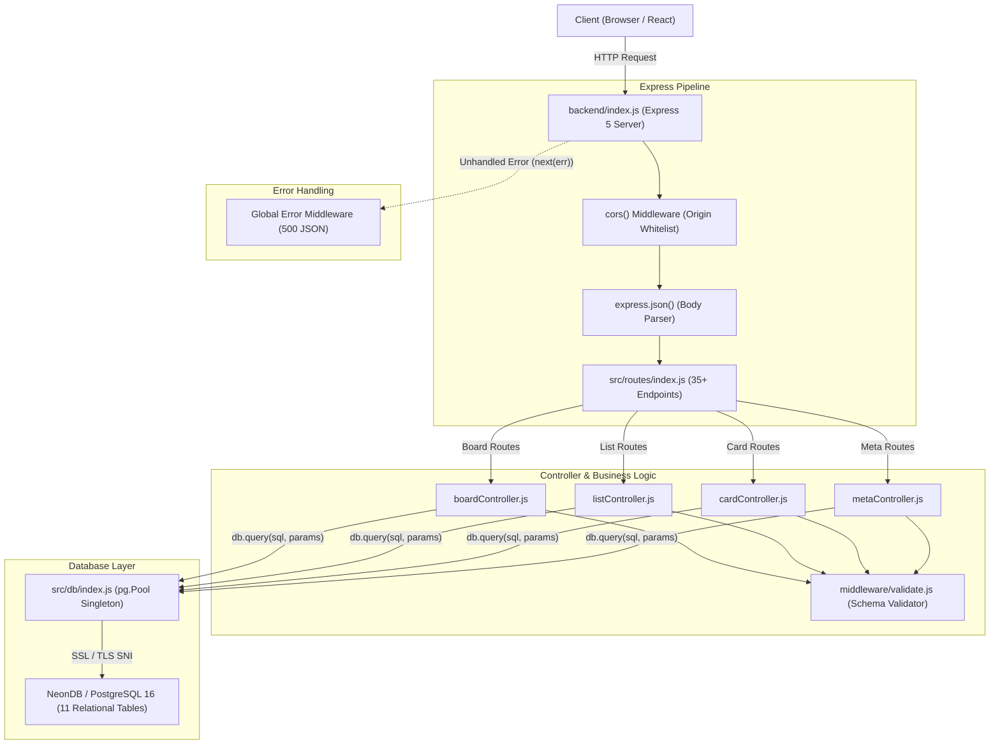

# 🛠️ KnabanX — Flow-Based Backend Code Deep Dive
# How Requests Travel from HTTP to PostgreSQL and Back

---

## 🧭 Why Study Backend by Execution Flow?

Looking at backend files individually (`index.js`, `routes/index.js`, `boardController.js`, `db/index.js`) leaves huge blind spots:
- How does Express actually match a route and pass control to a controller?
- What happens under the hood when `db.query()` is called? (DNS, SSL, Connection Pooling)
- Why does `getBoard` use `COALESCE(json_agg(...) FILTER ...)` instead of simple `JOIN`s?
- How does the card repositioning algorithm shift integer positions without corrupting the order?
- What happens if a database query crashes midway?

This guide breaks down the backend into **9 End-to-End Execution Lifecycles**. Each flow traces:
1. **The Incoming HTTP Request** (Method, URL, Headers, Body, Query Params)
2. **The Express Route & Middleware Pipeline** (CORS, Body Parser, Route Matching)
3. **The Controller Execution & Business Logic** (Validation, Algorithmic Processing)
4. **The Raw PostgreSQL Query & Execution Plan** (Parameters `$1, $2`, Aggregations, Indices)
5. **The Response Payload & Error Handling** (Status codes, JSON structure)

---

## 🗺️ Master Backend Architecture Flow



---

# 🎬 Flow 1: Server Initialization & Database Handshake

### 1. The Story
When you run `npm run dev` or `node index.js`, how does Express boot, how is CORS configured, and how does Node establish a secure connection pool to NeonDB PostgreSQL?

### 2. Execution Trace

```
node index.js
  ├── dotenv.config() -> loads .env variables
  ├── express() instance created
  ├── CORS middleware evaluated with dynamic whitelist
  ├── express.json() body parser registered
  ├── /health endpoint registered
  ├── /api routes mounted
  ├── Global error handler registered
  ├── Server listens on 0.0.0.0:PORT
  └── First db.query() triggers lazy getPool() in db/index.js
```

### 3. Detailed Code Walkthrough

#### Step 1: Dynamic CORS Configuration (`index.js` lines 8-21)
```javascript
// backend/index.js
const devOrigins = [
  'http://localhost:5173', 'http://localhost:5174', 'http://localhost:5175',
  'http://localhost:5176', 'http://localhost:5177', 'http://localhost:5178',
  'http://localhost:5179', 'http://localhost:5180', 'http://localhost:3000',
  'http://localhost:5100', 'https://kanban-style-management.netlify.app'
];

const allowedOrigins = process.env.FRONTEND_URL
  ? [...process.env.FRONTEND_URL.split(',').map(s => s.trim()), ...devOrigins]
  : devOrigins;

app.use(cors({
  origin: (origin, callback) => {
    // Allow requests with no origin (mobile apps, curl, Postman, server-to-server)
    if (!origin) return callback(null, true);
    if (allowedOrigins.includes(origin)) return callback(null, true);
    callback(new Error('Not allowed by CORS'));
  },
  credentials: true,
}));
```

**Interview Deep Dive: How CORS Works Here**
- **Browser preflight:** For complex requests (`PATCH`, `DELETE`, or requests with `Content-Type: application/json`), the browser first sends an `OPTIONS` HTTP request.
- The `cors` middleware inspects `req.headers.origin`.
- If `origin` matches any entry in `allowedOrigins`, it sets the HTTP response header:
  `Access-Control-Allow-Origin: <origin>` and `Access-Control-Allow-Credentials: true`.
- **The `!origin` check:** Essential for testing with Postman or Curl (which don't send an `Origin` header).

#### Step 2: The NeonDB Connection Pool & DNS Workaround (`src/db/index.js`)
```javascript
// backend/src/db/index.js
const { Pool } = require('pg');
const dns = require('dns').promises;
require('dotenv').config();

const dbUrl = process.env.DATABASE_URL || '';
const needsSsl = process.env.NODE_ENV === 'production' || dbUrl.includes('supabase') || dbUrl.includes('neon.tech');

let pool;

async function getPool() {
  if (pool) return pool;

  const config = {
    connectionString: dbUrl,
    ssl: needsSsl ? { rejectUnauthorized: false } : false,
    connectionTimeoutMillis: 10000, // 10s max wait to connect
    idleTimeoutMillis: 30000,       // 30s before idle client is closed
    max: 10,                        // Max 10 connections in pool
  };
```

**The NeonDB DNS Fix (Lines 22-44):**
```javascript
  if (dbUrl.includes('neon.tech')) {
    try {
      const url = new URL(dbUrl);
      const hostname = url.hostname;
      dns.setServers(['8.8.8.8', '8.8.4.4']); // Force Google DNS
      const addresses = await dns.resolve4(hostname);
      if (addresses.length > 0) {
        config.host = addresses[0];
        config.port = url.port || 5432;
        config.user = url.username;
        config.password = url.password;
        config.database = url.pathname.slice(1);
        config.ssl = { 
          rejectUnauthorized: false,
          servername: hostname // CRITICAL for TLS SNI verification
        };
        delete config.connectionString;
      }
    } catch (dnsErr) {
      console.warn('DNS lookup workaround failed, falling back to original URL:', dnsErr.message);
    }
  }

  pool = new Pool(config);
  return pool;
}
```

**Why this code exists (A Great Interview Story):**
- Serverless databases like Neon use cloud load balancers. On certain networks (or cloud hosting like Render/Vercel free tiers), default ISP DNS resolvers fail with `ENOTFOUND`.
- This custom logic uses Node's `dns.promises` to query Google's Public DNS (`8.8.8.8`) directly for the IPv4 address.
- **The `servername: hostname` setting:** When connecting by raw IP address over TLS/SSL, PostgreSQL certificates will be rejected unless you specify the Server Name Indication (SNI) header matching the hostname. This is advanced production networking code!

#### Step 3: Lazy Pool Query Execution
```javascript
module.exports = {
  query: async (text, params) => {
    const p = await getPool();
    return p.query(text, params);
  }
};
```
- Every controller imports `const db = require('../db')` and calls `db.query(sql, params)`.
- It borrows a connection from the pool, executes the parameterized query, and releases the connection back to the pool automatically.

---

# 🎬 Flow 2: Board Discovery & Personalization

### 1. The User Action
The frontend dashboard loads and requests all boards accessible to the logged-in user:
`GET /api/boards?member_id=1`

### 2. Request Lifecycle
```
Client: GET /api/boards?member_id=1
  │
  ▼
Express Pipeline: index.js -> routes/index.js -> b.getBoards
  │
  ▼
boardController.getBoards(req, res)
  │
  ▼
SQL Execution: SELECT b.*, EXISTS(...) FROM boards b ...
  │
  ▼
PostgreSQL Engine: Evaluates subquery for starred status
  │
  ▼
Response: 200 OK [ { id: 1, title: "Sprint", is_starred: true, ... } ]
```

### 3. Detailed Code Walkthrough

```javascript
// backend/src/controllers/boardController.js
exports.getBoards = async (req, res) => {
  const { member_id } = req.query;
  if (member_id) {
    const r = await db.query(`
      SELECT b.*, 
        EXISTS(SELECT 1 FROM starred_boards WHERE board_id = b.id AND member_id = $1) AS is_starred
      FROM boards b 
      WHERE b.member_id = $1 OR b.member_id IS NULL 
      ORDER BY b.created_at DESC`, 
      [member_id]
    );
    return res.json(r.rows);
  }
  const r = await db.query('SELECT *, FALSE as is_starred FROM boards ORDER BY created_at DESC');
  res.json(r.rows);
};
```

### 4. Deep SQL Query Breakdown

```sql
SELECT b.*, 
  EXISTS(
    SELECT 1 
    FROM starred_boards 
    WHERE board_id = b.id AND member_id = $1
  ) AS is_starred
FROM boards b 
WHERE b.member_id = $1 OR b.member_id IS NULL 
ORDER BY b.created_at DESC
```

**Key SQL Concepts Used Here:**
1. **Parameterized Input `$1`:** `member_id` is passed as `$1`. The `pg` driver sends the query text and the parameter in separate protocol messages. The SQL parser never treats `$1` as executable code, completely preventing SQL Injection.
2. **`EXISTS(SELECT 1 ...)`:**
   - Instead of doing a `LEFT JOIN starred_boards sb ON ...` which could duplicate rows if constraints fail, `EXISTS` is a Boolean subquery.
   - The database engine stops scanning the index the moment it finds the first matching row (`short-circuit evaluation`), making it O(1) with the composite primary key `(member_id, board_id)`.
3. **Multi-Tenant Filter `b.member_id = $1 OR b.member_id IS NULL`:**
   - Boards created by member 1 are returned.
   - Boards with `member_id IS NULL` (global default boards seeded during setup) are visible to all members.

---

# 🎬 Flow 3: The Board Mega-Query (`GET /api/boards/:id`)

### 1. The User Action
User clicks a board to open it. The frontend calls:
`GET /api/boards/5?member_id=1`

This is **the most complex query in the entire application**. It loads the entire board: lists, cards, labels, members, checklist progress, comment count, and attachment count in a single request without suffering from the N+1 problem.

### 2. Request Lifecycle
```
Client: GET /api/boards/5?member_id=1
  │
  ▼
boardController.getBoard
  ├── Query 1: Fetch Board Record + Star status
  ├── Query 2: Fetch Lists for this board (ORDER BY position)
  │    ├── Filter activeLists (archived = false)
  │    └── Filter archivedLists (archived = true)
  └── Query 3: Mega Aggregation Query for all Cards across all Lists
       ├── LEFT JOIN card_labels -> labels
       ├── LEFT JOIN card_members -> members
       ├── Correlated Subqueries for Checklist & Attachment & Comment counts
       ├── json_agg(DISTINCT ...) with FILTER clause
       └── Separate activeCards vs archivedCards
  │
  ▼
Response: 200 OK { id: 5, title: "...", lists: [...], cards: [...], ... }
```

### 3. Detailed Code Walkthrough

```javascript
// backend/src/controllers/boardController.js (lines 32-81)
exports.getBoard = async (req, res) => {
  const { id } = req.params;
  const { member_id } = req.query;

  // 1. Fetch Board Metadata
  const board = await db.query(`
    SELECT b.*, 
      EXISTS(SELECT 1 FROM starred_boards WHERE board_id = b.id AND member_id = $2) AS is_starred
    FROM boards b WHERE b.id = $1`, 
    [id, member_id || null]
  );
  if (!board.rows.length) {
    return res.status(404).json({ error: { code: 'NOT_FOUND', message: 'Board not found' } });
  }

  // 2. Fetch Lists
  const listsResult = await db.query('SELECT * FROM lists WHERE board_id=$1 ORDER BY position', [id]);
  const activeLists = listsResult.rows.filter(l => !l.archived);
  const archivedLists = listsResult.rows.filter(l => l.archived);
  const allListIds = listsResult.rows.map(l => l.id);

  let activeCards = [];
  let archivedCards = [];
  
  // 3. Fetch Cards with Aggregated Children
  if (allListIds.length) {
    const r = await db.query(
      `SELECT c.*,
        COALESCE(json_agg(DISTINCT jsonb_build_object('id',l.id,'name',l.name,'color',l.color)) FILTER (WHERE l.id IS NOT NULL), '[]') AS labels,
        COALESCE(json_agg(DISTINCT jsonb_build_object('id',m.id,'name',m.name,'avatar_url',m.avatar_url)) FILTER (WHERE m.id IS NOT NULL), '[]') AS members,
        (SELECT COUNT(*) FROM checklist_items ci WHERE ci.card_id = c.id) AS checklist_total,
        (SELECT COUNT(*) FROM checklist_items ci WHERE ci.card_id = c.id AND ci.is_complete = TRUE) AS checklist_done,
        (SELECT COUNT(*) FROM attachments a WHERE a.card_id = c.id) AS attachment_count,
        (SELECT COUNT(*) FROM comments co WHERE co.card_id = c.id) AS comment_count
       FROM cards c
       LEFT JOIN card_labels cl ON cl.card_id = c.id
       LEFT JOIN labels l ON l.id = cl.label_id
       LEFT JOIN card_members cm ON cm.card_id = c.id
       LEFT JOIN members m ON m.id = cm.member_id
       WHERE c.list_id = ANY($1::int[])
       GROUP BY c.id ORDER BY c.position`,
      [allListIds]
    );
    activeCards = r.rows.filter(c => !c.archived);
    archivedCards = r.rows.filter(c => c.archived);
  }

  res.json({ 
    ...board.rows[0], 
    lists: activeLists, 
    archived_lists: archivedLists,
    cards: activeCards,
    archived_cards: archivedCards
  });
};
```

### 4. Deep SQL Analysis: Why this is Senior-Level SQL

#### A. Array Inclusion with `= ANY($1::int[])`
Instead of generating dynamic SQL like `WHERE c.list_id IN (?, ?, ?)`, the query passes the entire JavaScript array `allListIds` directly into PostgreSQL:
```sql
WHERE c.list_id = ANY($1::int[])
```
- PostgreSQL treats `$1` as a single parameter of type integer array (`int[]`).
- Query plan caching: The database prepares a single plan regardless of whether there are 2 lists or 20 lists.

#### B. Eliminating the Cartesian Product with `json_agg(DISTINCT ...) FILTER`
When you join a card to multiple labels AND multiple members in the same query:
If a card has 3 labels and 2 members, a normal `LEFT JOIN` produces $3 \times 2 = 6$ rows for that single card!
To prevent duplicate label and member objects, the query does:
```sql
COALESCE(
  json_agg(DISTINCT jsonb_build_object('id',l.id,'name',l.name,'color',l.color)) 
  FILTER (WHERE l.id IS NOT NULL), 
  '[]'
) AS labels
```
- `jsonb_build_object`: Constructs a JSON object directly inside the database engine.
- `DISTINCT`: Deduplicates the objects created by the multiple joins.
- `FILTER (WHERE l.id IS NOT NULL)`: If a card has NO labels, `l.id` is null. Without this filter, `json_agg` would return `[null]`. With the filter, it returns `NULL`.
- `COALESCE(..., '[]')`: Converts `NULL` into an empty JSON array `[]` so the frontend never crashes on `card.labels.map()`.

#### C. Correlated Subquery Aggregations
For simple numeric counts (comments, attachments, checklists), doing additional `LEFT JOIN`s would exponentially explode the row count.
Instead, fast scalar subqueries are used:
```sql
(SELECT COUNT(*) FROM checklist_items ci WHERE ci.card_id = c.id AND ci.is_complete = TRUE) AS checklist_done
```
PostgreSQL uses the `cards(id)` index to calculate these counts in microseconds.

---

# 🎬 Flow 4: Drag-and-Drop & Card Position Shifting

### 1. The User Action
A user drags card ID 42 from position 5 in "To Do" to position 2 in "In Progress".
The frontend sends:
`PATCH /api/cards/42/move`
Body: `{ "newListId": 12, "newPosition": 2, "performed_by": 1 }`

### 2. The Algorithmic Challenge
In a Kanban board, cards are ordered by an integer `position` (1, 2, 3, 4, 5...).
When you insert a card at position 2:
1. Every card in the destination list at position $\ge 2$ must be shifted up by 1 ($2 \rightarrow 3$, $3 \rightarrow 4$).
2. Every card in the source list at position $> 5$ must be shifted down by 1 to fill the hole ($6 \rightarrow 5$, $7 \rightarrow 6$).

### 3. Detailed Code Walkthrough

```javascript
// backend/src/controllers/cardController.js (lines 112-145)
exports.moveCard = async (req, res) => {
  const { id } = req.params;
  const { newListId, newPosition, performed_by } = req.body;
  if (!newListId || newPosition === undefined)
    return res.status(400).json({ error: { code: 'VALIDATION_ERROR', message: 'newListId and newPosition required' } });

  // 1. Fetch current position and list of the card
  const old = await db.query('SELECT * FROM cards WHERE id=$1', [id]);
  if (!old.rows.length) 
    return res.status(404).json({ error: { code: 'NOT_FOUND', message: 'Card not found' } });

  const oldListId = old.rows[0].list_id;
  const oldPos = old.rows[0].position;

  if (String(oldListId) === String(newListId)) {
    // SCENARIO A: Reordering within the SAME list
    if (newPosition > oldPos) {
      // Moving DOWN: Shift intermediate cards UP by 1
      await db.query(
        'UPDATE cards SET position=position-1 WHERE list_id=$1 AND position>$2 AND position<=$3 AND archived=FALSE', 
        [newListId, oldPos, newPosition]
      );
    } else {
      // Moving UP: Shift intermediate cards DOWN by 1
      await db.query(
        'UPDATE cards SET position=position+1 WHERE list_id=$1 AND position>=$2 AND position<$3 AND archived=FALSE', 
        [newListId, newPosition, oldPos]
      );
    }
  } else {
    // SCENARIO B: Moving to a DIFFERENT list
    // 1. Close the gap in the old list
    await db.query(
      'UPDATE cards SET position=position-1 WHERE list_id=$1 AND position>$2 AND archived=FALSE', 
      [oldListId, oldPos]
    );
    // 2. Make room in the new list
    await db.query(
      'UPDATE cards SET position=position+1 WHERE list_id=$1 AND position>=$2 AND archived=FALSE', 
      [newListId, newPosition]
    );

    // 3. Log the activity with list names
    const lists = await db.query('SELECT id, title FROM lists WHERE id=ANY($1)', [[oldListId, newListId]]);
    const fromList = lists.rows.find(l => l.id === oldListId)?.title;
    const toList = lists.rows.find(l => String(l.id) === String(newListId))?.title;
    await logActivity(id, 'MOVE_CARD', performed_by, { from: fromList, to: toList });
  }

  // Finally, update the card itself
  const r = await db.query(
    'UPDATE cards SET list_id=$1, position=$2 WHERE id=$3 RETURNING *', 
    [newListId, newPosition, id]
  );
  res.json(r.rows[0]);
};
```

### 4. Mathematical Breakdown of the Shifts

#### Scenario A1: Moving Down in Same List (e.g. Pos 2 $\rightarrow$ Pos 5)
- Cards currently at positions 3, 4, 5 must move to 2, 3, 4.
- SQL: `SET position = position - 1 WHERE position > 2 AND position <= 5`
- Card 42 is then set to 5.

#### Scenario A2: Moving Up in Same List (e.g. Pos 5 $\rightarrow$ Pos 2)
- Cards currently at positions 2, 3, 4 must move to 3, 4, 5.
- SQL: `SET position = position + 1 WHERE position >= 2 AND position < 5`
- Card 42 is then set to 2.

#### Scenario B: Cross-List Move
- Old List: Remove item at 5 $\rightarrow$ all items $> 5$ shift down by 1 (`position = position - 1 WHERE position > 5`).
- New List: Insert at 2 $\rightarrow$ all items $\ge 2$ shift up by 1 (`position = position + 1 WHERE position >= 2`).
- Card 42 is updated to `list_id = newListId, position = 2`.

### 5. Critical Interview Question: "What can go wrong here?"
**Answer you should give to interviewers:**
> *"In the current implementation, these 3 queries (`UPDATE old list`, `UPDATE new list`, `UPDATE card`) execute independently without a database transaction (`BEGIN ... COMMIT`). If the server crashes or the connection drops between query 1 and query 2, the positions in the database will be inconsistent. To make this production-ready, I would wrap this entire block in a transaction using `await client.query('BEGIN')` and `ROLLBACK` on error."*

---

# 🎬 Flow 5: Creating Cards with Sequential Positioning

### 1. The User Action
User types a title in the "Add a card..." form and presses Enter:
`POST /api/lists/10/cards`
Body: `{ "title": "Implement WebSockets", "performed_by": 1 }`

### 2. Detailed Code Walkthrough

```javascript
// backend/src/controllers/cardController.js (lines 38-55)
exports.createCard = async (req, res) => {
  // 1. Validation
  const err = validate({ title: { required: true, min: 1, max: 100 } }, req.body);
  if (err) return res.status(400).json(err);
  
  const { id: listId } = req.params;
  const { title, description, performed_by } = req.body;
  if (description && description.length > 5000)
    return res.status(400).json({ error: { code: 'VALIDATION_ERROR', message: 'description max 5000 chars', field: 'description' } });

  // 2. Calculate next position at bottom of list
  const pos = await db.query('SELECT COALESCE(MAX(position),0)+1 AS next FROM cards WHERE list_id=$1', [listId]);
  
  // 3. Insert Card
  const r = await db.query(
    'INSERT INTO cards (list_id, title, description, position) VALUES ($1,$2,$3,$4) RETURNING *',
    [listId, title.trim(), description || null, pos.rows[0].next]
  );
  const card = r.rows[0];

  // 4. Audit Log
  await logActivity(card.id, 'CREATE_CARD', performed_by, { title: card.title });

  // 5. Return complete card shape
  res.status(201).json({ ...card, labels: [], members: [], checklist_items: [], attachments: [], comment_count: 0 });
};
```

**Key Patterns:**
1. **`COALESCE(MAX(position), 0) + 1`**: If the list is empty, `MAX(position)` returns `NULL`. `COALESCE` converts it to `0`, making the first card position `1`.
2. **`RETURNING *`**: PostgreSQL returns the inserted row (with its generated `id` and `created_at` timestamp) in the same roundtrip, avoiding a separate `SELECT` query.
3. **Empty Relationship Arrays in Response:** Returns empty `labels: []` and `members: []` so the frontend state doesn't crash on `undefined`.

---

# 🎬 Flow 6: Deep Card Inspection & Parallel Querying

### 1. The User Action
User clicks a card. The frontend calls:
`GET /api/cards/42`

### 2. Request Lifecycle
```
Client: GET /api/cards/42
  │
  ▼
cardController.getCard(req, res)
  ├── Verify card exists: SELECT * FROM cards WHERE id=42
  │
  └── Promise.all([
        1. Fetch Labels (JOIN card_labels)
        2. Fetch Members (JOIN card_members)
        3. Fetch Checklist items (ORDER BY position)
        4. Fetch Attachments (ORDER BY created_at)
        5. Fetch Comments (JOIN members for author details)
        6. Fetch Activity Logs (LEFT JOIN members for performer details)
      ])
  │
  ▼
Response: 200 OK { id: 42, title: "...", labels: [...], comments: [...], ... }
```

### 3. Detailed Code Walkthrough

```javascript
// backend/src/controllers/cardController.js (lines 9-36)
exports.getCard = async (req, res) => {
  const { id } = req.params;
  const card = await db.query('SELECT * FROM cards WHERE id=$1', [id]);
  if (!card.rows.length) return res.status(404).json({ error: { code: 'NOT_FOUND', message: 'Card not found' } });

  const [labels, members, checklistItems, attachments, comments, activity] = await Promise.all([
    db.query('SELECT l.* FROM labels l JOIN card_labels cl ON cl.label_id=l.id WHERE cl.card_id=$1', [id]),
    db.query('SELECT m.* FROM members m JOIN card_members cm ON cm.member_id=m.id WHERE cm.card_id=$1', [id]),
    db.query('SELECT * FROM checklist_items WHERE card_id=$1 ORDER BY position', [id]),
    db.query('SELECT * FROM attachments WHERE card_id=$1 ORDER BY created_at', [id]),
    db.query(`SELECT c.*, m.name AS author_name, m.avatar_url AS author_avatar
              FROM comments c JOIN members m ON m.id=c.author_id
              WHERE c.card_id=$1 ORDER BY c.created_at`, [id]),
    db.query(`SELECT al.*, m.name AS performer_name, m.avatar_url AS performer_avatar
              FROM activity_logs al LEFT JOIN members m ON m.id=al.performed_by
              WHERE al.card_id=$1 ORDER BY al.created_at DESC`, [id]),
  ]);

  res.json({
    ...card.rows[0],
    labels: labels.rows,
    members: members.rows,
    checklist_items: checklistItems.rows,
    attachments: attachments.rows,
    comments: comments.rows,
    activity: activity.rows,
  });
};
```

**Interview Deep Dive: Why `Promise.all` here?**
- Node.js is single-threaded, but the `pg.Pool` has multiple connections.
- `Promise.all` sends all 6 queries to PostgreSQL simultaneously across available pooled connections.
- The total response time equals the duration of the **single slowest query**, rather than the sum of all 6 queries running sequentially!

---

# 🎬 Flow 7: Partial Card Updates & Polymorphic Activity Logs

### 1. The User Action
User changes the card description and sets a due date:
`PATCH /api/cards/42`
Body: `{ "description": "Updated specs", "due_date": "2026-11-01T00:00:00Z" }`

Or user removes a due date:
Body: `{ "due_date": null }`

### 2. The Dynamic SQL Problem
In REST APIs, `PATCH` represents a partial update. The client only sends the fields that changed.
How do you write a single SQL query that only updates the fields provided without overwriting the others?

### 3. Detailed Code Walkthrough

```javascript
// backend/src/controllers/cardController.js (lines 58-83)
exports.updateCard = async (req, res) => {
  const { id } = req.params;
  const { title, description, cover_type, cover_value, archived, is_complete, due_date } = req.body;

  // Handle explicit null for due_date (removal)
  const dueDateVal = due_date === null ? null : (due_date || undefined);

  const r = await db.query(
    `UPDATE cards SET
      title=COALESCE($1,title), 
      description=COALESCE($2,description),
      cover_type=COALESCE($3,cover_type), 
      cover_value=COALESCE($4,cover_value),
      archived=COALESCE($5,archived), 
      is_complete=COALESCE($6,is_complete),
      due_date=CASE WHEN $8 THEN $7 ELSE COALESCE($7,due_date) END
     WHERE id=$9 RETURNING *`,
    [title?.trim(), description, cover_type, cover_value, archived, is_complete, dueDateVal, due_date === null, id]
  );
  if (!r.rows.length) return res.status(404).json({ error: { code: 'NOT_FOUND', message: 'Card not found' } });
  res.json(r.rows[0]);
};
```

**The SQL Trick Explained:**
1. **`COALESCE($1, title)`**: If `$1` is `NULL`, `COALESCE` falls back to the existing value of `title`.
2. **The `due_date` edge case:** What if the user intentionally wants to *clear* the due date by passing `null`?
   - With normal `COALESCE($7, due_date)`, passing `null` would fall back to the existing date!
   - Solved with parameter `$8` (`due_date === null` Boolean flag):
     `CASE WHEN $8 THEN $7 ELSE COALESCE($7, due_date) END`
   - If `$8` is `TRUE`, it explicitly sets `due_date = NULL`.

#### The `activity_logs` System (Lines 4-6)
```javascript
const logActivity = (cardId, actionType, performedBy, details) =>
  db.query('INSERT INTO activity_logs (card_id, action_type, performed_by, details) VALUES ($1,$2,$3,$4)',
    [cardId, actionType, performedBy || null, details ? JSON.stringify(details) : null]);
```
- The `details` column is PostgreSQL **`JSONB`**.
- This allows flexible payloads depending on the action:
  - `MOVE_CARD`: `{ from: "To Do", to: "Done" }`
  - `ADD_LABEL`: `{ label: "bug" }`
  - `COMPLETE_CHECKLIST_ITEM`: `{ item: "Write tests", complete: true }`
- No schema migrations needed when adding new activity types!

---

# 🎬 Flow 8: Global Multi-Board Search

### 1. The User Action
User types `"database"` into the search bar.
Frontend requests: `GET /api/cards/search?q=database`

### 2. Detailed Code Walkthrough

```javascript
// backend/src/controllers/cardController.js (lines 86-109)
exports.searchCards = async (req, res) => {
  const { q } = req.query;
  if (!q || q.trim().length < 1) return res.json([]);
  const search = `%${q.trim().toLowerCase()}%`;

  const r = await db.query(
    `SELECT
       c.id, c.title, c.description, c.due_date, c.is_complete, c.archived,
       c.cover_type, c.cover_value, c.list_id,
       l.title AS list_title, l.board_id,
       b.title AS board_title, b.bg_type, b.bg_value
     FROM cards c
     JOIN lists l ON l.id = c.list_id
     JOIN boards b ON b.id = l.board_id
     WHERE c.archived = FALSE
       AND l.archived = FALSE
       AND LOWER(c.title) LIKE $1
     ORDER BY b.id, l.position, c.position
     LIMIT 50`,
    [search]
  );
  res.json(r.rows);
};
```

**Key Performance Factors:**
- **3-Table Inner Join:** Joins `cards` $\rightarrow$ `lists` $\rightarrow$ `boards` to return the parent list title and board title so search results can be grouped by board.
- **`LOWER(c.title) LIKE $1`:** Case-insensitive search without requiring the PostgreSQL `ILIKE` operator.
- **Safety limit `LIMIT 50`:** Prevents overloading the client if the search matches thousands of cards.

---

# 🎬 Flow 9: Input Validation & The Error Handling Pipeline

### 1. The Story
What happens when a client sends invalid data (e.g. empty title, string instead of number, malformed URL)? How does the server catch it and return consistent JSON errors?

### 2. The Validation Engine (`src/middleware/validate.js`)

```javascript
// backend/src/middleware/validate.js
const validate = (rules, data) => {
  for (const [field, rule] of Object.entries(rules)) {
    const val = data[field];
    if (rule.required && (val === undefined || val === null || String(val).trim() === '')) {
      return { error: { code: 'VALIDATION_ERROR', message: `${field} is required`, field } };
    }
    if (val !== undefined && val !== null) {
      const str = String(val).trim();
      if (rule.min && str.length < rule.min)
        return { error: { code: 'VALIDATION_ERROR', message: `${field} must be at least ${rule.min} chars`, field } };
      if (rule.max && str.length > rule.max)
        return { error: { code: 'VALIDATION_ERROR', message: `${field} must be at most ${rule.max} chars`, field } };
      if (rule.url) {
        try { new URL(val); } catch {
          return { error: { code: 'VALIDATION_ERROR', message: `${field} must be a valid URL`, field } };
        }
      }
      if (rule.enum && !rule.enum.includes(val))
        return { error: { code: 'VALIDATION_ERROR', message: `${field} must be one of: ${rule.enum.join(', ')}`, field } };
    }
  }
  return null;
};
```

**How it is called inside controllers:**
```javascript
const err = validate({ 
  name: { required: true, min: 1, max: 30 }, 
  avatar_url: { required: true, url: true } 
}, req.body);

if (err) return res.status(400).json(err);
```

### 3. The Global Error Handling Middleware (`index.js` lines 31-35)

```javascript
// backend/index.js
app.use((err, req, res, next) => {
  console.error(err);
  res.status(500).json({ 
    error: { 
      code: 'INTERNAL_ERROR', 
      message: err.message 
    } 
  });
});
```
- In **Express 5**, any asynchronous error thrown inside an `async` route handler is automatically forwarded to this error middleware! (In Express 4, you had to manually write `try / catch` and call `next(err)`).
- Returns a standardized JSON error format: `{ error: { code: 'INTERNAL_ERROR', message: '...' } }`.

---

# 📊 Complete Backend API Reference & Database Impact

| Method | Route | Controller Function | Database Effect |
|---|---|---|---|
| `GET` | `/api/boards` | `boardController.getBoards` | `SELECT` boards with `EXISTS` check on `starred_boards` |
| `POST` | `/api/boards` | `boardController.createBoard` | `INSERT INTO boards` |
| `GET` | `/api/boards/:id` | `boardController.getBoard` | Complex multi-join with `json_agg` & correlated counts |
| `PATCH` | `/api/boards/:id` | `boardController.updateBoard` | `UPDATE boards SET ... COALESCE` |
| `DELETE` | `/api/boards/:id` | `boardController.deleteBoard` | `DELETE FROM boards` (Cascades to all lists/cards) |
| `POST` | `/api/boards/:id/toggle-star` | `boardController.toggleStar` | `INSERT` or `DELETE FROM starred_boards` |
| `GET` | `/api/boards/:id/activity` | `boardController.getBoardActivity` | `SELECT` from `activity_logs` joined with `members` |
| `POST` | `/api/boards/:id/lists` | `listController.createList` | `INSERT INTO lists` with `MAX(position)+1` |
| `PATCH` | `/api/lists/:id` | `listController.updateList` | `UPDATE lists` (rename, archive, color) |
| `PATCH` | `/api/lists/:id/reorder` | `listController.reorderList` | Batch `UPDATE lists SET position` |
| `DELETE` | `/api/lists/:id` | `listController.deleteList` | `DELETE FROM lists` (Cascades to cards) |
| `POST` | `/api/lists/:id/cards` | `cardController.createCard` | `INSERT INTO cards` + `INSERT INTO activity_logs` |
| `GET` | `/api/cards/search` | `cardController.searchCards` | 3-table join `cards` + `lists` + `boards` with `LIKE` |
| `GET` | `/api/cards/:id` | `cardController.getCard` | `Promise.all` across 6 tables |
| `PATCH` | `/api/cards/:id` | `cardController.updateCard` | `UPDATE cards` with dynamic `COALESCE` |
| `PATCH` | `/api/cards/:id/move` | `cardController.moveCard` | Positional shift queries + `INSERT INTO activity_logs` |
| `DELETE` | `/api/cards/:id` | `cardController.deleteCard` | `DELETE FROM cards` |
| `POST` | `/api/cards/:id/labels` | `cardController.addCardLabel` | `INSERT INTO card_labels ON CONFLICT DO NOTHING` |
| `DELETE` | `/api/cards/:id/labels/:labelId`| `cardController.removeCardLabel`| `DELETE FROM card_labels` |
| `POST` | `/api/cards/:id/members` | `cardController.addCardMember` | `INSERT INTO card_members ON CONFLICT DO NOTHING` |
| `DELETE` | `/api/cards/:id/members/:memberId`| `cardController.removeCardMember`| `DELETE FROM card_members` |
| `POST` | `/api/cards/:id/checklist-items` | `cardController.addChecklistItem` | `INSERT INTO checklist_items` |
| `PATCH` | `/api/checklist-items/:id` | `cardController.updateChecklistItem` | `UPDATE checklist_items` |
| `DELETE` | `/api/checklist-items/:id` | `cardController.deleteChecklistItem` | `DELETE FROM checklist_items` |
| `POST` | `/api/cards/:id/attachments` | `cardController.addAttachment` | `INSERT INTO attachments` |
| `DELETE` | `/api/cards/:id/attachments/:attachmentId` | `cardController.deleteAttachment` | `DELETE FROM attachments` |
| `POST` | `/api/cards/:id/comments` | `cardController.addComment` | `INSERT INTO comments` + `activity_logs` |
| `DELETE` | `/api/cards/:id/comments/:commentId` | `cardController.deleteComment` | `DELETE FROM comments` |
| `GET` | `/api/labels` | `metaController.getLabels` | `SELECT * FROM labels` |
| `POST` | `/api/labels` | `metaController.createLabel` | `INSERT INTO labels` (validated against palette) |
| `GET` | `/api/members` | `metaController.getMembers` | `SELECT * FROM members` |
| `POST` | `/api/members` | `metaController.createMember` | `INSERT INTO members` |

---

## 🎯 Master Interview Cheatsheet: Backend

When an interviewer asks:
> *"How does your backend handle complex relational data and high-concurrency card movements?"*

**Answer with this exact structure:**
1. **Raw SQL over ORM:** *"I chose raw parameterized SQL queries with `pg.Pool` instead of an ORM like Prisma or Sequelize. This gave me full control to write advanced SQL aggregations, such as using `COALESCE(json_agg(DISTINCT ...))` with `FILTER` clauses in `getBoard`, which loads lists, cards, labels, and member assignments in a single query, completely eliminating the N+1 problem."*
2. **Positional Shifting Algorithm:** *"In `moveCard`, rather than re-indexing every card on the board, I implemented an arithmetic range shift. When moving a card from position 5 to 2, the backend executes `UPDATE cards SET position = position + 1 WHERE position >= 2 AND position < 5`. For cross-list moves, it decrements items above the old position in the source list and increments items above the new position in the target list."*
3. **Database Performance & Connection Management:** *"I implemented connection pooling with `pg.Pool` configured with connection and idle timeouts. For our serverless NeonDB PostgreSQL instance, I wrote a custom DNS resolution fallback using Google DNS (`8.8.8.8`) with TLS SNI verification to guarantee connection stability under cloud deployments."*
4. **Idempotent Operations:** *"For relationship tables like `card_labels` and `card_members`, I used `INSERT ... ON CONFLICT DO NOTHING` to ensure that accidental duplicate requests never corrupt join tables."*
